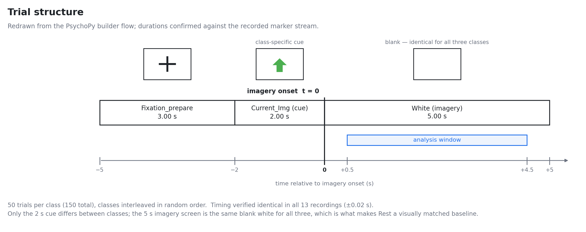
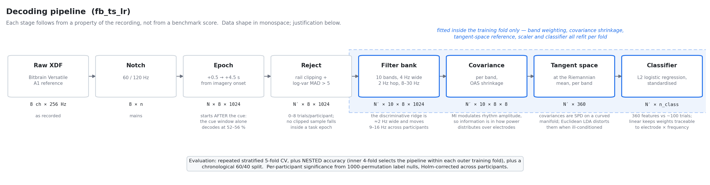
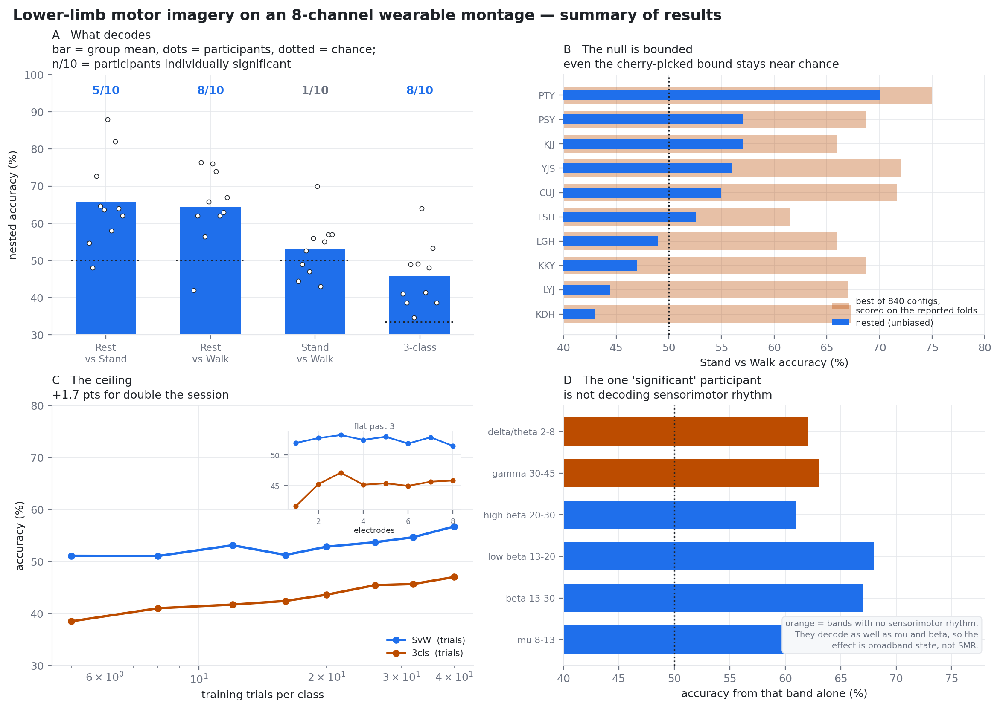

# 8채널 웨어러블 EEG 몽타주에서 하지 운동심상 디코딩 가능성의 경계 설정: 안정은 검출되나 기립과 보행은 분리되지 않는다

**초안 v1 (한국어판).** 영문판 `PAPER_DRAFT.md`와 내용·수치가 동일합니다. 모든 수치는 이 폴더의 스크립트로 추적되며, 각 결과 뒤 대괄호 안에 출처 스크립트를 표기했습니다. `⟨꺾쇠⟩` 안의 문구는 저자가 채워야 할 자리입니다.

목표 학술지: IEEE TNSRE (참조 패러다임 Ma *et al.* 2023과 일치)

---

## 초록

**목적.** 하지 외골격용 뇌–컴퓨터 인터페이스(BCI)는 안정(rest), 기립(standing-up), 보행(walking) 의도를 구분해야 한다. 저가 8채널 웨어러블 몽타주가 그 구분을 지원할 수 있는지는 알려져 있지 않다. 기존 실증 연구는 56–64전극 연구용 시스템을 사용한다.

**방법.** 참가자 10명이 안정·기립·보행의 운동심상을 각 50시행 수행했으며, Bitbrain Versatile 8채널 몽타주로 256 Hz에서 기록했다. 디코딩은 필터뱅크 리만 접공간(Riemannian tangent-space) 특징에 중첩 교차검증(nested cross-validation)을 적용했고, FBCSP와 EEGNet을 포함한 18개 파이프라인과 비교했다. 주장은 참가자별 순열 귀무분포, 시간순 분할, 보정 재표집 *t*-검정, 지형 기반 생리학적 스크린으로 검정했다.

**결과.** 안정은 두 심상 조건 모두에 대해 검출되었다 — 보행 대비 64.5 %(참가자 8/10에서 유의), 기립 대비 65.8 %(5/10). 둘 다 참가자 수준에서 유의하다(*p* ≤ .0026, *n* = 10). 기립 대 보행은 53.1 %(1/10)에 그쳤고, 참가자 수준에서 우연보다 유의하게 높지 않으며(*p* = .246, 95 % CI [47.5, 58.7]), ~70 % 실용성 문턱보다는 유의하게 *낮다*(*p* = 4.1 × 10⁻⁵).

*이 양성 결과에는 유보가 하나 붙는다: 시각적으로 일치된 안정 조건 대비, 예상된 mu ERD를 보인 참가자는 1/10뿐이었다. 따라서 안정–심상 분리를 시각 주의의 차이가 아닌 운동심상에 특정하여 귀속할 수 없다.*

음성 결과는 단순히 달성되지 못한 것이 아니라 경계 지어져 있다. 840개 설정 탐색을 보고 대상 폴드에서 낙관적으로 채점해도 평균 68.4 %였고 10명 중 7명이 70 % 미만이었다. 학습곡선은 세션을 두 배로 늘려도 +1.7점을 준다. 정확도는 전극 3개에서 포화한다. 기립과 보행의 지형도는 한 조건을 무작위로 반씩 나눈 것보다 더 다르지 않다(비율 1.07–1.12, *p* > .46). 한 참가자가 67 %에 도달했으나, 그 효과는 감각운동 리듬이 아니라 공간적으로 균일한 각성·근긴장 차이였다.

동일 하드웨어에서 수행한 ME(motor execution) 양성 대조는 *실행된* 두 동작을 모든 참가자에서 **91.1 %**로 분리한다. 따라서 본 연구의 어떤 결과도 기록 실패에 기인하지 않는다. 그러나 그 분리는 말초성이다 — 베타는 운동 중 상승하고 운동 후 반동을 보이지 않는다 — 그리고 피질 성분은 깊이 1.56 dB의 mu 특이적 골에 불과하다. **본 논문이 보고하는 모든 정확도의 순서는 해당 대비에서 가용한 말초 신호의 순서를 따르며, 패러다임이 유발하려던 피질 차이의 순서를 따르지 않는다.**

**결론.** 복합사지(compound-limbs) 요소는 본 구현에서 도움이 될 수 없으나, 그 이유는 비대칭의 부재보다 구체적이다. Ma *et al.*이 보고한 이득은 거울상 배치가 *서로 다른 클래스*에 있을 것을 요구한다. 본 연구의 보행 지시는 두 배치를 한 시행 안에 넣었고, 거기서는 시행 평균 편측성 대비가 이를 상쇄한다(+0.026 dB, *p* = .73). 시행 내 교대에 대한 타이밍 무관 검정 6종과 정점 고정 분석을 수행했으며, 가장 강한 결과는 +1.02 dB에 디코딩 56.1 %(*p* = .0084)로 검정한 열 개 가설에 대한 보정을 통과하지 못한다. 따라서 그 질문은 답해진 것이 아니라 열려 있다.

**의의.** 임상적으로 동기화된 대비에 대한 경계 지어진 음성 결과를 제시하며, 저채널 몽타주에서 정확도와 순열 *p*값만으로는 BCI 주장의 근거가 되지 못한다는 점을 실증한다.

**색인어** — 운동심상, 하지, 저채널 EEG, 리만 기하, 음성 결과, EMG 오염

---

## I. 서론

⟨표준 도입 2문단: 외골격 BCI, 하지 운동심상이 중요한 이유, 저가 웨어러블 몽타주가 실사용에서 중요한 이유. 랩 폴더에 이미 있는 하지 운동심상 선행연구를 인용할 것.⟩

Ma *et al.* [1]은 최근 하지 운동심상에 반대측 상지 스윙을 추가하면 심상 디코딩 정확도가 73.70 ± 12.47 %에 이르며, 이는 자신들의 단일 하지 패러다임보다 **11.02점 높다**고 보고했다. 자연스러운 보행 패턴에 맞추려는 복합사지 설계다. 그 결과는 256채널 g.HIamp 증폭기에 연결된 56전극 헤드캡을 1200 Hz로 사용하고, 아티팩트 제거를 위한 EOG 4채널과 sEMG 4채널을 두었으며, 전자기 차폐 환경에서 얻은 것이다.

보행 외골격은 어느 다리가 내딛는지 알 필요가 없다. 착용자가 가만히 있으려는지, 일어서려는지, 걸으려는지를 알아야 한다. [1]의 좌–우 대비가 아니라 이 세 상태가 기기가 실제로 구축될 클래스 집합이며, 사람이 실제로 착용할 수 있는 하드웨어에서 이들이 분리되는지는 어떤 연구도 확립한 바 없다.

두 질문이 뒤따르며, 이것이 본 논문의 주제다.

**Q1. 임상적으로 요구되는 클래스 집합 — 안정, 기립, 보행 심상 — 이 소비자급 8채널 몽타주에서 분리되는가?**

**Q2. [1]의 복합사지 요소 — 상상된 걸음에 반대측 팔 스윙을 짝짓는 것 — 를 도입하면 그 클래스 집합에서 도움이 되는가?**

**Q1의 답은 *부분적으로*다.** 안정은 두 심상 조건 모두에 대해 검출된다. 기립과 보행 심상은 서로 분리되지 않는다.

**Q2는 제기된 형태로는 답할 수 없었으며, 그 자체가 발견이다.** [1]에서 복합사지 조작이 이용하는 기제는 반대측 C3/C4 비대칭이며, 이는 두 클래스가 서로 거울상일 때만 발생한다. 본 연구에서 거울상 쌍은 보행 시행 *안에* 존재한다 — 지시가 두 걸음을 명시하므로 두 배치가 순차적으로 발생한다 — 클래스 *사이*가 아니며, 시행 평균 대비는 이를 구성상 상쇄한다. 따라서 우리는 그 이득이 8채널로 전이되는 데 실패했다고도, 비대칭이 부재한다고도 보고하지 않는다. 이 클래스 집합이 그것을 **클래스 간 대비가 닿을 수 없는 위치**에 놓았다고 보고한다. §IV-A가 남는 것을 정량화하고, §III-J가 교대를 직접 복원하려는 가장 강한 시도를 보고한다.

**기여.**

1. 임상적으로 동기화된 세 클래스에 대한 8채널 웨어러블 몽타주에서의 중첩 교차검증 벤치마크. 집단 평균이 아니라 참가자별로 보고한다.
2. 기립 대 보행 심상에 대한 *경계 지어진* 음성 결과. 단일 파이프라인에서 단언한 것이 아니라 전처리와 디코더 계열에 대한 전수 탐색으로 확립했다.
3. 그 귀무 결과에 대한 단언이 아닌 *생리학적 설명*: 두 조건은 한 조건을 무작위로 반씩 나눈 것보다 더 다르지 않은 두피 지형도를 만든다. 몽타주가 실효적으로 약 1.5개의 공간 차원만 포괄한다. 그리고 의도적으로 잘못된 해부학적 위치를 겨냥한 공간 제약은, 국소화된 신호를 실제로 담고 있는 대비에서는 4.5점을 잃게 하면서 이 대비에서는 아무 대가도 치르지 않는다.
4. 명백히 유의한 디코딩 결과를 각성·근육 아티팩트로 식별해내는 스크린 — 공간 기울기, 리듬 특이성, 대역 절제, 기록 중단 구간을 가로지르는 안정성 — 과, 통상적으로 쓰이는 에폭 구간이 도입하는 시각 단서 누출의 정량화(단서 구간만으로 52–56 %).
5. 스크린을 가정하지 않고 *검증*하는 ME 양성 대조: 동일한 기준이 실행된 운동을 비피질성으로 분류하며, 스크린이 사용하지 않는 독립적인 운동 후 베타 반동 검정도 같은 판정에 도달한다. 이 대조는 기록 실패를 귀무 결과의 설명에서 배제하며, 본 논문이 보고하는 모든 정확도를 설명하는 단일 기제 — 말초·전역 신호에 의한 지배 — 를 산출한다.

---

## II. 방법

### A. 참가자 및 윤리

참가자 10명 ⟨연령, 성별, 이용손⟩. ⟨연구윤리 승인 기관 및 번호⟩. 전원 서면 동의를 제공했다.

### B. 패러다임

세 조건을 무작위 순서로 제시했다: **안정**(모니터를 응시하고 아무것도 상상하지 않음), **기립**(일어서는 것을 상상), **보행**(두 걸음을 상상하되 오른발 내딛기와 왼팔 스윙으로 시작 — [1]에서 채택한 복합사지 요소).

각 시행은 3.0 s 응시 화면, 2.0 s 클래스별 단서, 1 s 비프음으로 시작되는 5.0 s 심상 구간(백색 빈 화면)으로 구성되었다. 참가자당 클래스별 50시행(총 150)을 수집했다. 마커 구조와 타이밍은 13개 기록 파일 전체에서 동일함을 확인했다(참가자 3명은 기록이 중단되어 재시작되었으며, 캡을 벗기지 않은 채 같은 날 34–46분 간격으로 두 파일이 생성되었다. 시행은 사전 지정된 유지 규칙으로 선별되었고 모든 런에서 클래스가 균형을 이룬다) [`steam_io.py`].

결정적으로, **안정 조건은 심상 조건과 시각적으로 동일하다** — 동일한 지속시간, 동일한 빈 화면, 동일한 비프음, 동일한 선행 단서 — 오직 심상만 제거되었다. 이 덕분에 안정 클래스가 없는 참조 패러다임으로는 불가능한 조작 확인(manipulation check)이 가능하다.

**그림 1.** 시행 구조. 3.00 s 응시 → 2.00 s 클래스별 단서 → 5.00 s 빈 화면 심상. PsychoPy 빌더 흐름도에서 다시 그렸으며 기록된 타이밍과 대조 확인했다(13개 파일 전체 ±0.02 s). 클래스 간 차이는 단서뿐이며 심상 화면은 세 조건 모두 동일하다. 이것이 안정을 시각적으로 일치된 기준선으로 만든다. 시간축은 심상 시작 시점 기준이다.

### C. 기록

Bitbrain Versatile 8채널, 능동 차폐가 적용된 수분 기반 반건식(water-based semi-dry) 센서를 FC3, FC4, C3, C4, Cz, CP3, CP4, CPz에 배치하고 왼쪽 귓불(A1)을 기준전극으로 사용했다. 256 Hz, LSL을 통해 PsychoPy 마커 스트림과 함께 XDF로 기록했다. EOG나 EMG 채널은 기록하지 않았고 전자기 차폐도 사용하지 않았다.

두 가지 장비 특성이 분석에 관련된다. 첫째, 8채널 구성은 3차 저역통과가 적용된 DC–40 Hz의 아날로그 대역폭을 가지므로, 40 Hz를 넘는 대역은 기기 감쇠를 통과해 측정된다. 이 사양은 제조사 레퍼런스 가이드에 기재되어 있지 않아 기록 자체에서 확인했다. 스펙트럼 파워는 20–40 Hz에서 −7.6 dB/옥타브, 40–80 Hz에서 −15.8 dB/옥타브로 감소한다 [그림 16]. 그 영역에 닿는 것은 §II-G의 M4 아티팩트 지표뿐이다. 둘째, 제조사는 수분 기반 시스템에 대해 수치 임피던스 문턱을 정의하지 않으며, 센서 품질은 기록 전에 기기 자체의 신호품질 표시기로 정성적으로 확인한다. 따라서 젤 기반 몽타주처럼 임피던스를 kΩ 단위로 보고할 수 없으며, 이를 누락된 기준이 아니라 재현성 한계로 명기한다.

### D. 전처리

60/120 Hz 노치로 전원선 간섭을 제거했다. 이는 예방책이 아니라 필수 단계다. 무필터 기록에서 60 Hz 선은 **주변 스펙트럼보다 22 dB 높고** mu 대역 정점보다도 2.5 dB 높으며, 120 Hz 고조파도 주변보다 약 10 dB 높게 남아 있다. 데이터는 8–30 Hz 대역통과(FIR, firwin)로 필터링하고 심상 시작 기준 **+0.5 ~ +4.5 s**로 에폭화했다.

두 선택은 정당화가 필요하다. 첫째, 에폭이 **단서 구간을 배제한다**. 단서는 클래스별 시각 자극이므로 심상 시작 이전부터 시작하는 어떤 구간도 시각 유발 반응을 끌어들인다. 이를 결과에서 정량화한다. 둘째, **재참조를 적용하지 않았다**. CAR(공통평균 참조)를 시험했으나 1.1점 *나빴다*. 8개 전극이 모두 감각운동 피질 위에 있으므로 CAR은 잡음만이 아니라 신호를 포함한다 [`run_sweep.py`].

어느 채널이든 증폭기 레일에서 클리핑이 발생했거나 로그 분산이 해당 채널 중앙값에서 강건 표준편차 5를 초과한 시행은 기각했다(참가자당 0–8시행 기각). 증폭기 포화는 여러 기록에서 나타났으나 전적으로 블록 간 휴식 구간에 속했으며, 과제 에폭 내부에서는 클리핑된 표본이 발생하지 않았다 [`01_diagnose.py`].

### E. 디코딩 파이프라인과 그 형태의 근거

파이프라인은 벤치마크 성능으로 선택한 것이 아니라 기록의 속성으로부터 도출했다. 그림 2가 각 단계의 데이터 형상과 근거, 그리고 교차검증 학습 폴드 내부에서 재적합되는 범위의 경계를 요약한다.

운동심상은 시간 고정된 유발전위를 만들지 않는다. 진행 중인 감각운동 리듬의 *진폭*을 변조한다 [4]. 따라서 판별 정보는 대역 제한된 파워가 전극 간에 어떻게 분포하는가 — 즉 **대역통과된 신호의 공간 공분산** — 에 있다. 채널별 대역 파워는 소스의 방향과 깊이를 담는 채널 간 구조를 버린다. 원시 시계열 모델은 공간·스펙트럼 필터링을 데이터로부터 학습해야 하는데, 클래스당 약 50시행에서는 독립 표본보다 파라미터가 많아진다.

공분산 행렬은 대칭 양정치이며 굽은 다양체 위에 있다. 유클리드 연산은 거리를 왜곡하며, 행렬의 조건수가 나쁠수록 — 바로 여기의 소표본 영역에서 — 그 왜곡이 심하다. 따라서 **리만 평균에서의 접공간**으로 사영하며 [6], 그 이후에는 선형 분류기가 기하학적으로 타당하다.

참가자별 채널 × 주파수 지도를 보면 판별 능선의 폭이 약 2 Hz이고 중심이 참가자마다 9–16 Hz로 변한다. 단일 8–30 Hz 공분산은 이를 평균해 없애므로, 신호를 **4 Hz 폭의 중첩 대역 10개(2 Hz 간격, 8–30 Hz)** 로 분해하고 대역 가중을 학습 폴드 내부에서 참가자별로 학습한다.

30 Hz 상한은 근육 오염을 줄이지만 없애지는 못한다. Goncharova *et al.* [9]는 두피 EMG의 지형적 확산이 "주파수가 올라갈수록 커지며 40 Hz 위에서 최대"라고 보고하므로, 30 Hz 상한은 오염이 가장 널리 퍼지는 범위를 배제한다. 그러나 통과대역을 깨끗하게 만들지는 못한다. 같은 연구는 전두근 EMG 진폭이 "전두부에서 20–30 Hz에 최대"라고 보고하고, 20–30 Hz 성분을 **EMG 베타 리듬**이라 명명하며, "약한 수축조차 두피 전체에서 EEG 알파, mu, 베타 리듬을 가리거나 흉내내는 EMG를 만들 수 있다"고 결론짓는다. 즉 분석 대역은 실제 EMG 성분과 겹치며, 바로 그 때문에 8–30 Hz 내부의 디코딩 정확도 자체는 피질성으로 간주될 수 없고, §II-G의 생리학적 스크린이 선택이 아니라 필수인 것이다. 본 데이터셋에서의 EMG 존재는 결과에서 실증한다.

그 결과 얻어지는 360개 접공간 특징을 약 100시행에 대해 **L2 정규화 로지스틱 회귀**로 분류한다. 선형 모델은 가중치를 특정 전극 쌍과 주파수로 역추적할 수 있게 하며, 이것이 §III-E의 생리학적 스크린을 가능하게 한다.

이 파이프라인을 `fb_ts_lr`로 표기한다. 비교를 위해 18개 파이프라인을 추가로 구현했다 — CSP+LDA, CSP+SVM, MDM, FgMDM, 접공간 변이형, 시간지연(CSSP 계열) 공분산, 윈도우 공분산, FBCSP 변이형 3종 [5](대역별 CSP 이후 상호정보 기반 최적 개별 특징 선택, LDA·SVM·랜덤포레스트 분류기), 크롭 앙상블 [10], EEGNet-8,2 [7] [`decoders.py`, `eegnet.py`].

**그림 2.** 디코딩 파이프라인. 각 단계를 데이터 형상 및 그것을 동기화하는 기록의 속성과 함께 제시한다. 음영 영역은 교차검증 학습 폴드 내부에서 재적합되는 모든 것 — 대역 가중, 공분산 축소, 접공간 기준점, 스케일러, 분류기 — 을 표시한다.

### F. 평가 프로토콜

**분석 단위.** 본 논문의 모든 추론 검정은 **참가자**를 독립 단위로 취급한다(*n* = 10). 시행은 참가자 내부에 중첩되어 있어 독립이 아니다. 시행을 합산한 검정은 기술적(descriptive)이라고 명시한 경우에만 보고한다. 집단 수준 주장은 참가자별 값 10개에 대한 일표본 또는 대응표본 *t*-검정을, 참가자별 주장은 해당 참가자 자신의 시행에 대한 순열 귀무분포를 사용한다.

참가자·대비별로 세 수치를 보고한다.

1. **반복 층화 5-겹 교차검증**(5회 반복). 통상적인 수치.
2. **중첩 정확도**: 내부 4-겹 교차검증이 각 외부 학습 폴드 안에서 파이프라인을 선택하므로, 보고되는 폴드가 모델 선택에 관여하지 않는다. 약 100시행에서 다수 파이프라인 중 최선을 보고 대상 교차검증으로 고르면 정확도가 수 점 부풀려진다. 우리가 인용하는 것은 중첩 수치다.
3. **시간순 정확도**: 취득 순서상 앞 60 % 시행으로 학습하고 뒤 40 %로 검정하여, 세션 내 표류가 클래스 정보로 학습되는지를 탐지한다.

모든 공간 필터, 접공간 기준점, 스케일러, 특징 선택기는 학습 폴드 내부에서만 적합된다 [`02_final_eval.py`].

참가자별 유의성은 1000회 순열 레이블 귀무분포에 참가자 10명에 대한 Holm 보정을 적용해 판정했다. 파이프라인 비교는 Nadeau–Bengio 보정 재표집 *t*-검정 [8]을 사용했다. 이 검정은 중첩된 재표집이 도입하는 "학습 집합 선택에 기인한 변동성"에 대해 교차검증 추정치의 분산을 보정한다. 비보정 대응 검정은 여기서 반보수적이며, 그 편향의 크기를 보이기 위해서만 보고한다 [`09_stats.py`].

### G. 생리학적 검증

정확도와 순열 *p*값은 *무언가가* 조건을 분리한다는 것만 확립한다. 그 무언가가 감각운동 피질인지 검정하기 위해, 어떤 정확도 값도 보기 **전에** 운동심상 생리학으로부터 네 지표를 정의했다 [`11_neuro_criterion.py`].

- **M1, 공간 기울기**: 전극 간 (max|*r*| − min|*r*|)/max|*r*|, 8–30 Hz. 피질 소스는 불균등하게 투사되지만 전역 상태는 그렇지 않다.
- **M2, 리듬 특이성**: 8–30 Hz의 평균 *r*²를 2–8 Hz 및 30–45 Hz의 평균 *r*²로 나눈 값. mu/beta 밖에는 감각운동 리듬(SMR)이 없다.
- **M3, 중심 집중도**: {Cz, CPz, C3, C4, CP3, CP4}의 평균|*r*|을 {FC3, FC4}의 평균|*r*|로 나눈 값. 발 표상은 내측에 있다.
- **M4, EMG 비**: 30–45 Hz의 평균|*r*|을 8–30 Hz의 평균|*r*|으로 나눈 값. 두 가지 단서가 붙는다. EMG에도 20–30 Hz 성분이 있으므로 [9], M4가 낮다고 해서 EMG가 없는 신호임이 보증되지는 않으며, 근육이 지배하는 범위에서 스펙트럼이 멀어져 있음만을 뜻한다. 그리고 증폭기의 아날로그 대역폭이 DC–40 Hz이므로(§II-C), 30–45 Hz 분자는 일부가 3차 롤오프 안에 놓여 기기에 의해 감쇠된다. 따라서 M4는 동일 하드웨어를 공유하는 참가자 간 *상대* 지표로는 타당하지만, 절대 크기는 실제 고주파 성분을 과소평가한다 — 이는 M4의 양성 소견을 보수적으로 만든다.

사전 지정 예측: 분리 가능성이 신경성이라면 정확도는 M1–M3와 양의 상관을, M4와 음의 상관을 가진다.

추가로, 시각적으로 일치된 안정 조건을 기준선으로 삼아 **조작 확인**을 수행했다 — 운동심상은 그에 대비해 mu/beta에 ERD를 일으켜야 한다 [`12_manipulation_check.py`] — 그리고 복합사지 기제를 편측성 지수(우반구 {FC4,C4,CP4} 대 좌반구 {FC3,C3,CP3}의 대역 파워)로 직접 검정했다.

---

## III. 결과

### A. 프로토콜 검증

마커 구조는 13개 파일 전체에서 동일했다. 세션당 응시 마커 150개와 9종 시행 마커 각 50개, 화면 지속시간 3.00·2.00·5.00 s(파일 간 범위 ±0.02 s). 클래스 균형은 두 기록 파일에 걸친 참가자 3명을 포함해 모든 런에서 정확했다 [`steam_io.py`].

### B. 디코딩 정확도

그림 3이 이어지는 네 결과를 요약한다.

**그림 3.** (A) 대비별 중첩 정확도. 막대는 집단 평균, 빈 원은 개별 참가자, 점선은 우연 수준, *n*/10은 순열 귀무분포 대비 개별적으로 유의한 참가자 수. (B) 참가자별 기립 대 보행: 중첩 정확도(진한색)와 보고 대상 폴드에서 참가자별 최적 설정을 채점해 얻은 840개 설정 중 최선의 경계(연한색). 그 낙관적 절차 아래에서도 경계는 우연에 가깝게 남는다. (C) 천장 곡선 — 클래스당 학습 시행 수에 대한 정확도, 전극 수는 삽입 그림. (D) 개별적으로 유의한 단일 참가자의 대역 절제: SMR이 없는 델타/세타와 감마가 mu·beta만큼 잘 디코딩되며, 이는 SMR이 아니라 광대역 상태 차이를 시사한다.

**표 I — 중첩 교차검증 정확도, 참가자 10명 평균 ± 표준편차** [`02_final_eval.py`]

| 대비 | 정확도 | 우연 | 범위 | 95 % CI | *t*(9) 우연 대비 | *d* |
|---|---|---|---|---|---|---|
| 안정 대 기립 | 65.8 ± 12.1 % | 50 | 48–88 | [57.1, 74.5] | +4.11, *p* = .0026 | 1.30 |
| 안정 대 보행 | 64.5 ± 10.3 % | 50 | 42–76 | [57.1, 71.9] | +4.42, *p* = .0017 | 1.40 |
| **기립 대 보행** | 53.1 ± 7.9 % | 50 | 43–70 | **[47.5, 58.7]** | **+1.24, *p* = .246** | 0.39 |
| 3클래스 | 45.8 ± 8.7 % | 33 | 35–64 | [39.5, 52.0] | +4.51, *p* = .0015 | 1.43 |

**독립 단위는 시행이 아니라 참가자다**(*n* = 10). 시행은 참가자 내부에 중첩되어 있으므로, 집단 전체 약 1000시행을 합산한 이항 검정은 상관된 관측을 독립으로 취급하여 비현실적으로 작은 *p*값을 낸다. 대신 참가자 수준 일표본 *t*-검정을 보고한다. 이 구분은 중심 대비에서 결정적이다. 시행을 합산하면 기립 대 보행이 유의해 보이지만(*p* = .026), 참가자 수준에서는 **우연보다 유의하게 높지 않으며 CI가 우연을 포함한다**.

미세 필터뱅크에 대한 참가자별 최적화와 소프트 투표 앙상블은 기립 대 보행을 54.5 %로, 3클래스를 48.2 %로 올렸다 [`05_optimize.py`].

**음성 결과의 형식적 경계 설정.** 비유의한 결과 자체는 부재의 증거가 아니므로, *p* > .05로부터 추론하는 대신 경계를 직접 검정한다. 실용적 BCI 제어의 최소치로 통상 인용되는 ~70 % 정확도 [2], [3] 대비, 기립 대 보행 정확도는 문턱보다 유의하게 *낮다*(단측 *t*(9) = −6.78, *p* = 4.1 × 10⁻⁵) — 기각 실패가 아니라 적극적 실증이다. 다만 우연과의 등가성에 대한 TOST(두 단측 검정)은 ±5점 여유에서 정확한 등가성 주장을 **지지하지 않는다**(*p* = .232). 등가성은 ±8점에서만 지지된다(*p* = .040). 따라서 방어 가능한 진술은 양쪽으로 경계 지어진다. 참된 기립 대 보행 정확도는 우연으로부터 대략 8점 이내에 있으며, 기기를 구동할 수 있는 수준보다는 실증적으로 낮다. 그것이 정확히 우연이라고 주장하지는 않는다.

합산 3클래스 혼동행렬은 오류 전체를 국소화한다 [`fig_confusion_3cls.png`]. 안정은 53 %로 복원되는 반면 기립과 보행은 서로 36 %와 34 %의 질량을 교환한다. 안정은 모든 참가자에서 우연보다 높게 복원된다. **3클래스 문제와 기립 대 보행 문제는 같은 문제다.**

`fb_ts_lr`이 네 대비 모두에서 최고 평균 정확도를 달성했다. 그러나 보정 재표집 *t*-검정 아래에서 16개 파이프라인 대비 중 어느 것도 유의에 도달하지 않았다(모두 *p* ≥ .247). 비보정 대응 검정은 안정 대 기립에서 `fb_ts_lr` 대 CSP+LDA에 *p* = .046을 주었다. 따라서 `fb_ts_lr`을 최고 성능이라고 기술하되 유의하게 우월하다고는 기술하지 않는다. EEGNet-8,2는 고전적 파이프라인보다 낮았다(기립 대 보행 51.8 %, 3클래스 42.1 %) [`04_deep.py`].

**시간순 검증.** 앞 60 % 시행으로 학습하고 뒤 40 %로 검정한 비용은 최대 1.4점이었다(안정 대 기립 65.6 %, 안정 대 보행 65.1 %, 3클래스 46.0 %). 따라서 세션 내 표류는 보고된 정확도에 기여하지 않는다.

### C. 참가자별 유의성

**표 II — 개별적으로 우연을 초과한 참가자 수(1000회 순열 귀무분포, Holm 보정)** [`09_stats.py`, 그림 3]

| 대비 | 유의 |
|---|---|
| 3클래스 | 8 / 10 |
| 안정 대 보행 | 8 / 10 |
| 안정 대 기립 | 5 / 10 |
| 기립 대 보행 | 1 / 10 |

안정 대 기립은 집단 평균이 가장 높으면서도 개별적으로 유의한 참가자는 가장 적으며, 산포가 가장 넓다(± 12.1). 집단 평균만으로는 이 두 대비의 순위가 뒤집힌다.

**표 IIb — 두 안정–심상 대비의 나란한 비교**

| | 안정 대 **기립** | 안정 대 **보행** |
|---|---|---|
| 중첩 정확도 | 65.8 ± 12.1 % | 64.5 ± 10.3 % |
| 참가자 간 범위 | 48–88 % | 42–76 % |
| **개별 유의(Holm)** | **5 / 10** | **8 / 10** |
| 시간순 분할 비용 | −1.4점 | −0.7점 |
| M2 리듬 특이성 | 1.60 | **1.83** |
| M4 EMG 비(낮을수록 깨끗) | 0.98 | **0.74** |
| M3(중심 집중도) 대 정확도 | ρ = +0.28, *p* = .43 | **ρ = +0.55, *p* = .097** |

**집단 평균이 더 낮음에도 안정 대 보행이 더 강한 결과다.** 네 가지 독립적 근거가 있다. 5명이 아니라 10명 중 8명에서 유의하다. 산포가 더 좁다. 생리학적으로 더 깨끗한 대비다(감마 영역 오염이 적고 판별력이 mu/beta에 더 많이 국한된다). 그리고 사전 지정된 생리학적 기준이 디코딩 성능을 조금이라도 예측하는 유일한 대비다.

안정 대 기립 순위에는 별도의 문제도 있다. 그 최고 득점자는 §III-E에서 안정 대 기립 효과가 36 Hz에서 정점을 이루고 지형이 평탄함(M4 = 1.78)이 밝혀진 참가자다 — 즉 그 순위표의 정상이 근육 아티팩트다. 안정 대 보행에는 오염된 참가자에 대한 이에 비견할 의존이 없다.

따라서 **안정 대 보행을 주된 양성 소견**으로, 안정 대 기립을 부차적 소견으로 보고한다.

### D. 기립 대 보행 음성 결과의 경계 설정

세 가지 독립 분석이 수렴한다.

**(1) 전수 설정 탐색.** 참가자당 에폭 구간 15 × 대역 7 × 참조 2 × 파이프라인 4 = 840개 설정. 이어서 각 참가자가 *보고 대상과 동일한 폴드에서 채점된* 단일 최적 설정을 고르도록 허용했다 — 결과로서는 옹호할 수 없는, 의도적으로 낙관적인 절차다. 참가자별 최댓값은 **61.5–75.0 %(평균 68.4 %)** 였다. 10명 중 7명은 실용적 BCI 제어의 최소치로 통상 인용되는 ~70 % 미만에 머문다 [2], [3]. 이를 넘은 3명(75.0, 72.0, 71.7 %)도 채점되는 바로 그 폴드에서 설정을 고르는 절차 아래에서만 그러하며, 사전적으로 얻을 수 있는 정확도가 아니다 [`07_svw_focus.py`].

**(2) 시간 구조 없음.** 기립 심상은 약 2 s의 단일 자세 전이인 반면 보행 심상은 단서 구간 전체에 걸치므로, 두 클래스가 시행 후반에 갈릴 수 있다. 15개 구간 전체의 주변 정확도는 51.4–52.9 %였고, 후반 [3.5, 5.0] s 구간은 52.4 %로 전체 구간보다 낫지 않았다.

**(3) 효과 크기.** 채널 × 주파수 정점 *r*²의 대평균은 기립 대 보행에서 0.034였고, 안정 대 기립 0.062, 안정 대 보행 0.074와 대비된다. 효과 자체는 생리학적으로 정합적이다 — 보행 중 파워가 더 높은 C3/C4/CP4 상의 약 13 Hz 능선 — 그러나 고정확도 단일시행 디코딩에는 대략 한 자릿수 부족하다 [그림 6, `01_diagnose.py`].

### E. 개별 참가자 스크리닝: 유의해 보이나 신경성이 아닌 결과

참가자 1명(P06)이 기립 대 보행에서 67.0 %에 도달했다(순열 *p* = .004, Holm 보정 *p* = .040). 개별적으로 유의한 유일한 사례다. 참가자 10명이 모두 우연 수준이고 *n* = 100시행일 때 10명 중 최댓값의 기댓값이 약 58 %이므로, 이 값은 선택만으로 생기는 수준을 넘는다.

그럼에도 네 가지 생리학적 검사가 이를 기각한다 [`10_s06_physiology.py`].

**표 III — 생리학적 스크린, 참가자 P06, 기립 대 보행**

| 검사 | 결과 | 해석 |
|---|---|---|
| *r*² 지도의 정점 | FC4, **36 Hz**, *r* = .45 | EMG 영역 |
| mu(8–13) 지형 | 8개 전극 전부에서 +.20 ~ +.26, 최대/최소 = 1.27 | 공간적으로 균일 |
| 감마(30–45) 지형 | 8개 전부에서 −.23 ~ −.32, 최대/최소 = 1.41 | 공간적으로 균일 |
| 대역 절제 | mu 64 %, beta 67 %, 감마 63 %, 델타/세타 62 % | 모든 대역이 동등 |
| 대역별 정점 *r*² | 감마 30–45 Hz **0.083** > mu 8–13 Hz 0.072 > beta 0.026 | SMR이 없는 곳에서 최대 |
| 파일 1 학습 → 파일 2 검정(46분 후, 동일 캡) | 76.2 % → **60.0 %**(*p* = .25) | 구간을 가로질러 불안정 |

진정한 하지 SMR은 Cz/CPz에 국소적이고 명확한 공간 기울기를 가지며 mu/beta에 국한된다. 이 기준들은 §III-I에서 독립적으로 검증된다. 거기서 동일한 스크린이 실행된 운동을 비피질성으로 분류하며, 스크린이 사용하지 않는 운동 후 베타 반동 검정도 같은 판정에 도달한다.

P06이 보이는 것은 보행 상상 중 전역적으로 균일한 알파 증가와 전역적으로 균일한 30–45 Hz 감소이며, SMR이 존재하지 않는 델타/세타에서도 동등하게 디코딩되고, 같은 기록 일정 안에서 46분 뒤에 재현되지 않는다. 감마 결과는 보수적이다. 30–45 Hz는 증폭기 롤오프 안에 있으므로(§II-C) 거기서 얻은 63 %는 기기 감쇠를 *통과해* 도달한 값이며, 기저의 근육 활동은 대역 제한된 수치가 시사하는 것보다 강하다. 마지막 항목은 정확히 진술할 가치가 있다. 두 파일 사이에 캡을 벗기지 않았으므로 76.2 %에서 60.0 %로의 붕괴는 전극 위치나 임피던스 변화로 귀속될 수 없고, 신호 자체를 반영해야 한다. 이는 광대역 상태 차이다. 그 참가자는 기립을 상상할 때보다 보행을 상상할 때 전역적으로 더 이완되어 있었다.

**이는 일반화된다.** 사전 지정 기준을 참가자 10명 전원에 적용하면, 네 지표 중 어느 것도 기립 대 보행 정확도를 예측하지 못했고(M1 ρ = +.13, M2 ρ = −.01, M3 ρ = +.19, M4 ρ = +.16; 모두 *p* > .60), M4는 *거꾸로* 갔다. EMG 오염이 클수록 정확도가 높았다. 최고 디코더 두 명이 가장 광대역인 참가자 두 명이었던 반면, 감각운동 서명이 가장 깨끗한 참가자는 우연 수준에 머물렀다 [`11_neuro_criterion.py`]. 안정 대 보행에서는 기준이 더 잘 작동했다(네 지표 중 셋이 예측 방향, 중심 집중도 ρ = +.55, *p* = .097).

*n = 10과 12개 상관에서 어느 것도 p < .05에 도달하지 않으므로 이들은 기술적이다. 하중을 지는 주장은 지지의 부재와 M4의 부호다.*

### F. 조작 확인

시행 전 응시 화면 대비로는 세 조건 모두 −1.3 ~ −2.9 dB를 보여 표준적 ERD 현상을 재현했다 [4]. 그러나 **시각적으로 일치된 안정 조건** 대비로는, 운동심상이 mu 파워의 *증가*를 만들었다 — 기립 +0.55 dB(*p* = .014), 보행 +0.77 dB(*p* = .008) — 전극 전반에 균일하고 베타 효과는 없었다. 예상된 ERD를 보인 참가자는 1/10뿐이었다 [`12_manipulation_check.py`].

방향, 지형, 대역 모두가 감각운동 활성화와 불일치한다. 우리는 이를 안정 지시에 귀속한다. 안정 조건은 능동적 시각 응시를 요구한 반면 심상 조건은 암묵적으로 초점 이완을 유도했으며, 이는 알파를 전역적으로 높이는 조작이다.

이는 귀속 문제를 넘어 Q1에 영향을 미친다. 시각적 관여로 안정과 심상을 분리하는 디코더는 실사용 경로가 없다. 외골격 사용자는 모니터를 응시하지 않으며, 여기서 65 %를 실어나른 교락은 부재할 것이다. 따라서 안정–심상 결과는 **유리한 교락 아래에서 얻은 상한**으로 읽어야 하며, 동일 몽타주가 실사용에서 달성할 값의 추정치로 읽어서는 안 된다. §IV-F가 이를 위해 필요한 패러다임 변경을 기술한다.

### G. 천장 분석

**시행 수.** 정확도는 학습 시행 수의 10배당 기립 대 보행에서 +5.5점(95 % CI +2.1 ~ +8.8), 3클래스에서 +9.0점(CI +6.5 ~ +11.5) 상승했다. 따라서 세션을 두 배로 늘리는 것은 각각 약 +1.7점, +2.7점의 가치를 가진다. 측정된 최대 지점에서 로그선형으로 외삽하면 ~70 % 실용성 문턱에 도달하기 위해 기립 대 보행은 클래스당 **약 10,200시행**, 3클래스는 **약 13,800시행**이 필요하다 [`06_ceiling.py`].

*이 두 수치는 관측 범위(클래스당 10–50시행)의 약 200배 밖으로 외삽한 것이며, 추정치가 아니라 자릿수 진술로 읽어야 한다. 로그선형 증가는 검증된 것이 아니라 가정된 것이고, 경험적 학습곡선은 대개 계속 상승하기보다 포화한다 — 그렇다면 실제 요구량은 더 작아지는 것이 아니라 더 커진다. 측정된 양이자 논증이 의지하는 것은 기울기 자체다: 10배당 +5.5점(CI +2.1 ~ +8.8), 문턱까지의 격차 17점 대비.*

**전극 수.** 학습 폴드 내부에서 부분집합을 고르는 탐욕적 전방 선택 아래에서 정확도는 전극 3개에서 포화했다(기립 대 보행: 전극 1·3·8개에 대해 52.0 → 53.3 → 51.5 %; 3클래스: 41.7 → 47.1 → 45.8 %). 가장 자주 선택된 첫 전극은 CP3/CP4/CPz였다. 이 몽타주의 나머지 다섯 전극은 아무것도 더하지 않는다 — 하나의 공간 상관 덩어리 안에 놓여 있다.

### H. 귀무 결과의 생리학적 설명: 왜 이 기록에는 디코딩할 것이 없는가

§III-B부터 §III-D까지는 기립과 보행이 *디코딩될* 수 없음을 확립한다. 이 절은 그 앞의 질문 — 두 조건이 두피에서 애초에 다른 패턴을 만들기는 하는가? — 을 다루고, 이어서 몽타주의 무엇이 그 차이의 해상을 가로막는지를 묻는다.

**H.1 기록된 지형도는 잡음 바닥과 구분되지 않는다.** 솔깃한 비교, 즉 기립 빼기 안정 지형도와 보행 빼기 안정 지형도의 상관은 타당하지 않다. 둘 다 −안정 항을 포함하므로 구성상 상관된다. 실측하면 그 비교는 r = +0.67을 주지만, 같은 데이터를 재참조하면 +0.47(기립을 기준선으로)과 +0.19(보행을 기준선으로)로 이동한다. 즉 공유된 기준선이 지배한다.

대신 각 대비를 표본 크기를 맞춘 해당 참가자 자신의 잡음 바닥과 비교한다. 한 조건의 시행을 무작위로 반씩 나누고, 두 반쪽 지형도 사이의 거리를 순수 잡음으로 삼는다. 클래스 간 거리도 같은 크기의 반쪽을 쓰므로 잡음 기여가 구성상 동일하고 공유되는 기준선이 없다. 비율 = 1.00은 두 조건이 한 조건의 무작위 두 반쪽만큼만 다르다는 뜻이다(참가자당 200회 분할) [`19_topography_floor.py`].

**표 IIIa — 조건 내 잡음 바닥 대비 지형 거리**

| 대비 | mu 8–13 Hz, 비율 [95 % CI] | *p* | beta 13–30 Hz, 비율 [95 % CI] | *p* |
|---|---|---|---|---|
| 안정 대 보행 | **1.78** [1.18, 2.38] | **.023** | 1.29 [1.01, 1.57] | .079 |
| 안정 대 기립 | 1.51 [0.85, 2.18] | .118 | 1.39 [0.80, 1.98] | .205 |
| **기립 대 보행** | **1.12** [0.70, 1.55] | .463 | **1.07** [0.83, 1.31] | .683 |

*구간은 참가자 10명 평균 비율에 대한 95 % CI이며, p값은 기저의 클래스 간·조건 내 거리에 대한 대응 검정에서 나온다. 둘은 서로 다른 귀무가설을 다루므로(비율 = 1 대 차이 = 0), 안정 대 보행 베타 구간이 1.0을 배제하면서도 대응 p가 .079인 일이 생긴다. 그 칸은 결론 유보로 처리한다. 두 대역 모두에서 구간이 잡음 바닥에 중심을 두는 것은 기립 대 보행뿐이며, 두 기준 모두에서 명백한 것은 mu의 안정 대 보행뿐이다.*

이 순서는 디코딩 결과(개별 유의 8/10, 5/10, 1/10)를 정확히 재현하는데, 분류기도 교차검증도 사용하지 않는 측정에서 그러하다. 10명 중 6명은 기립 대 보행 비율이 1.0 미만이다. 즉 클래스 간 거리가 자기 자신의 잡음보다 *작다*. 2.0을 넘는 유일한 참가자는 §III-E가 각성·근긴장으로 지목한 그 참가자다.

**이것이 실패의 위치를 특정한다.** 이 기록에서 기립과 보행 심상은 애초에 다른 두피 패턴을 만들지 않는다. 따라서 실패는 디코더의 한계도, 디코딩 단계의 시행 수 한계도 아니다. 디코더가 찾을 패턴 차이가 없는 것이다.

**경쟁 설명들과 그중 살아남는 것.** "패턴 차이가 기록되지 않았다"는 처음에는 세 주장과 양립한다. 기록이 사용 불가였다, 기립과 보행 심상이 이 몽타주에서 분리되지 않는다, 이 열 명의 참가자가 분리 가능한 심상을 만들지 않았다.

첫 번째는 §III-I의 양성 대조로 배제된다. 동일한 전극·증폭기·디코더에서 실행된 운동이 모든 참가자에서 91 %로 분리되므로, 본 논문의 어떤 결과도 망가진 파이프라인이나 사용 불가한 기록에 귀속될 수 없다.

세 번째는 배제할 수 없다. 참가자는 심상 능력에 대해 선별되지 않았고, 피드백 훈련을 받지 않았으며, 심상 선명도 설문을 작성하지 않았다. 즉 과제 수행이 측정된 적이 없다. §III-F의 조작 확인이 유일하게 가용한 탐침인데 예상된 ERD를 보인 참가자는 1/10뿐이었다. ME는 참가자가 *수행할 수 있음*을 보일 뿐 *상상했음*을 보이지 않는다. 따라서 차이를 해상하지 못하는 몽타주와 차이를 만들지 않은 참가자를 분리할 수 없으며, §IV-F가 그것을 분리할 설계 변경을 열거한다.

**H.2 그럼에도 몽타주는 옳은 곳을 향하고 있다.** 단일 전극 디코딩은 모든 대비에서 내측 부위를 전측방 부위보다 상위에 놓는다(대비 평균으로 Cz 58.1 %와 CPz 57.3 %가 최상, C4 54.8 %와 FC4 54.4 %가 최하) — 측방 생성원이 아니라 내측 발 표상에서 기대되는 순서다.

**H.3 명시적 해부학 제약을 더해도 도움이 되지 않지만, 잘못 겨냥하면 대가가 있다.** 일반 파이프라인을 네 가지 생리학적 제약 변이형과 비교했다. 발 영역 표면 라플라시안(Cz − mean(C3, C4, CPz) 및 CPz, C3, C4에서의 대응 유도), 개인별 추정 mu·beta 대역(레이블 없는 스펙트럼 정점; 참가자 전반에서 mu 9.0–13.0 Hz, beta 15.0–28.5 Hz. 전원에게 교과서적 8–13 / 13–30을 적용하는 것과 대비), 네 개 내측 유도로 제한한 CSP, 명시적으로 명명된 대역 파워 특징. 다섯 번째 변이형이 대조군이다. 동일한 기계를 라플라시안 고리만 *전측방* 전극 중심으로 옮긴 것으로, 하지 심상이 존재할 해부학적 이유가 없는 위치다 [`18_physio_classifier.py`].

**표 IIIb — 생리학적 제약 변이형(5-겹, 동일 폴드)**

| 모델 | 안정 대 기립 | 안정 대 보행 | 기립 대 보행 |
|---|---|---|---|
| A 일반(본문 전반에서 사용) | 62.7 ± 9.8 % | 63.5 ± 9.7 % | 54.3 ± 5.2 % |
| B + 발 영역 라플라시안 | 62.8 ± 11.6 | 65.2 ± 10.7 | 55.3 ± 7.5 |
| C + 개인별 감각운동 리듬 대역 | 62.2 ± 12.8 | 62.5 ± 9.4 | 53.3 ± 5.3 |
| D 완전 생리학적 제약 | 63.7 ± 11.4 | 62.8 ± 8.0 | 53.0 ± 8.6 |
| **E 동일 기계, 잘못된 해부학** | **59.6 ± 10.5** | **59.0 ± 10.3** | **54.6 ± 6.3** |

*참가자 10명 평균 ± 표준편차이며 모든 모델에 동일 폴드를 사용했으므로 모델 간 대비는 대응 관계다. 아래 인용하는 모델 간 검정은 그 10개 값에 대한 대응 t-검정이다. 표준편차가 모델 간 차이에 비해 크다 — 집단 평균만으로는 어떤 모델도 다른 모델과 구분되지 않으며, 그것이 대응 검정을 쓰는 이유다.*

어떤 제약도 유의하게 개선하지 않는다(B–D 대 A, 모두 *p* > .37). 개인별 추정 대역은 오히려 약간 *해로웠는데*, 미세 필터뱅크가 이미 그 적응을 흡수했기 때문이다. 두 가지가 따라 나온다.

첫째, 일반 파이프라인은 생리학에 대해 임의적이지 않다. 발 영역 제약이 부과할 것을 이미 추출하고 있으며, 그래서 제약을 더해도 아무것도 바뀌지 않는다.

둘째, 잘못된 해부학 대조군은 안정 대 보행에서 **4.5점**(*p* = .019), 안정 대 기립에서 **3.1점**(*p* = .267)의 대가를 치르지만, 기립 대 보행에서는 전혀 대가가 없다(**−0.4점, *p* = .804** — 명목상 *개선*). 동일한 오도가 신호를 담은 대비에서는 비싸고 담지 않은 대비에서는 공짜다.

*이 비교는 결정적이라기보다 시사적이며, 이유는 둘이다. 첫째, 바닥 효과다. 안정 대 보행은 우연보다 13.5점 위에 있고 기립 대 보행은 4.3점뿐이므로 전자에 파괴할 신호가 약 3배 많고, 비대칭의 일부는 그것만으로 따라 나온다. 그 자체로만 보면 논증은 순환적이다 — 공간 제약은 무언가로부터만 오도될 수 있으므로, "오도가 공짜다"와 "국소화된 신호가 없다"는 서로에 대한 독립 증거라기보다 거의 같은 진술이다. 둘째, 이 몽타주는 8개 전극을 모두 감각운동 피질 위에 두므로 "잘못된" 고리도 약하게만 잘못되어 있다. 후두나 전전두 부위는 가용하지 않다. 이 대조군은 H.1 및 H.4와 정합적이기 때문에 보고하는 것이지, 그것들을 독립적으로 확립하기 때문이 아니다.*

**H.4 몽타주는 전극 수보다 훨씬 적은 공간 차원을 측정한다.** H.1은 구분 가능한 지형 차이가 존재하지 않음을 보이지만, 그 자체로는 두 읽기를 분리하지 못한다. 뇌에 차이가 없거나, 차이는 있는데 이 몽타주가 해상하지 못하거나. 두 번째 읽기는 직접 다룰 수 있다.

참가자별 8×8 대역 제한 공분산을 고유분해하면:

| | 참가자 평균 |
|---|---|
| 분산의 95 %를 설명하는 성분 수 | 8개 중 **3.4** |
| 유효 차원(참여비, participation ratio) | **1.49** |
| 전극 간 평균 상관 | **0.783** |

8개 전극이 실효적으로 약 **1.5개**의 공간 차원을 포괄한다. 이웃한 부위가 0.78로 상관되어 있다 — 즉 대체로 같은 양을 보고한다. 이는 전극 3개에서 포화한 §III-G의 탐욕적 채널 곡선과 같은 결론에 이르는 독립 경로다. 한쪽 측정은 분류 정확도이고 다른 쪽은 공분산의 고윳값 스펙트럼인데, 둘이 일치한다.

따라서 몽타주는 공간적으로 포화되어 있다. *이 간격에서* 전극을 더해도 정보가 늘지 않으며, 그것이 §III-G가 측정한 바다. 약 2 cm 간격의 더 조밀한 내측 고리가 도움이 될지는 다른 질문이며 본 데이터셋으로는 답할 수 없다. 그 전극이 기록되지 않았기 때문이다. §IV-A의 간격 논의와 §IV-E의 한계를 참조하라.

**H.5 근육을 제거해도 신호가 복원되지 않으며, 분해 기반 제거를 시도하면 존재하는 신호가 파괴된다.** H.1은 지형 차이가 없음을, H.4는 몽타주가 공간적으로 포화되었음을 보이지만, 둘 다 세 번째 가능성을 배제하지 못한다. 실제 차이가 존재하는데 근전도 잡음에 묻혀 있을 가능성이다. 분석 대역이 실제 EMG 성분과 겹치므로(§II-E) 이는 논증이 아니라 검정으로 다루어야 했다.

독립성분분석(ICA)은 여기서 쓸 수 없다. *N*채널 기록을 *N*개 성분으로 분해하는데, H.4가 이 몽타주의 유효 차원을 1.49로 측정했다. 1.5차원 공간은 신경 부분공간과 근육 부분공간으로 나뉠 수 없다. 따라서 채널 수가 적어도 쓸 수 있는 두 방법을 사용했다 [`22_emg_removal.py`]. 첫째는 시행별 30–45 Hz 잡음 방향을 접공간 특징에서 회귀로 제거하는 것으로, 회귀는 학습 폴드 내부에서만 적합했다. 둘째는 BSS-CCA다. 신호와 그 1표본 지연 사이의 정준상관이 성분을 자기상관 순으로 정렬하므로, 자기상관이 가장 낮은 — 가장 근육에 가까운 — 두 성분을 0으로 만들고 재구성한다. 모든 결과에 대한 해석은 실행 전에 배정했다.

**표 IIIc — EMG 제거의 효과 (단일 대역 파이프라인, 동일 폴드)**

| 대비 | 원본 | 잡음 회귀 제거 | BSS-CCA |
|---|---|---|---|
| 기립 대 보행 | 50.9 % | 50.8 % (Δ −0.12, *p* = .938) | 47.1 % (Δ −3.88, *p* = .180) |
| 안정 대 보행 | 62.9 % | 62.8 % (Δ −0.10, *p* = .938) | **53.8 % (Δ −9.08, *p* < .0001)** |
| 안정 대 기립 | 62.9 % | 61.4 % (Δ −1.57, *p* = .427) | **53.6 % (Δ −9.29, *p* = .055)** |
| 안정 대 보행 지형 비율 | 1.79 | — | **1.25 (*p* = .032)** |
| 참가자 P06, 기립 대 보행 | 66.0 % | **61.0 %** | **47.0 %** |

*이 단계는 필터뱅크가 아니라 단일 8–30 Hz 공분산을 쓰므로 절대값이 표 I보다 몇 점 낮다. 동일 폴드를 사용하는 단계 내 원본-대-정제 비교만 해석한다.*

세 결과가 따라 나오며, 각각 사전등록 표의 다른 갈래에 해당한다.

**잡음 회귀 제거는 아무것도 바꾸지 않으며, 그것이 정보다.** 기립 대 보행이 −0.12점 움직이고(*p* = .938) 두 안정 대비도 움직이지 않는다. 귀무 결과가 신호대잡음비 문제였다면, 근육과 상관된 분산원을 제거했을 때 개선되었어야 한다. 개선되지 않는다. 병목은 잡음이 아니라 **정보량**이며, 이는 §III-G의 평탄한 학습곡선과 전극 3개 포화가 다른 경로로 도달한 것과 같은 결론이다.

**P06은 두 방법 모두에서 하락한다.** 66.0 %에서 61.0 %와 47.0 %로 떨어진다. 이 참가자는 §III-E가 각성·근긴장으로 기각한 그 참가자이며, 그 기각이 내놓는 예측이 정확히 이것이다. 근육을 제거하면 효과가 사라져야 한다. 사라진다.

**BSS-CCA는 과제거하며, 과제거한다는 사실 자체가 결과다.** 안정 대 보행에서 9.1점(*p* < .0001), 안정 대 기립에서 9.3점을 잃고, 안정 대 보행의 지형 비율을 1.79에서 1.25로 붕괴시킨다(*p* = .032). 즉 이 몽타주가 실증적으로 해상하는 유일한 대비를 파괴한다. 따라서 그 기립 대 보행 출력은 해석할 수 없다. 이유는 H.4의 차원이다. 8개 성분 중 2개를 버리는 것은 기록된 공간의 4분의 1을 버리는 것이고, 그 공간이 유효 1.49차원을 포괄할 때 신호를 함께 담지 않은 아티팩트 부분공간은 존재하지 않는다. **이는 분해 기반 아티팩트 제거가 이 채널 수에서는 사용할 수 없음을 측정으로 보인 것이며**, ICA 문헌이 이론적으로 주장하는 바를 저채널 시스템 사용자가 선호가 아니라 **경성 제약**으로 다루어야 함을 뜻한다.

### I. 양성 대조: 신호가 명백할 때 이 몽타주가 기록하는 것

위의 모든 주장은 지금까지 어떤 것도 검정하지 않은 전제에 조건부다. 즉 이 몽타주가 애초에 하지 감각운동 활동을 기록할 수 있는가, 그리고 M1–M4 스크린이 그것이 존재할 때 알아보는가. 그럴 수 없다면 §III-D와 §III-H의 귀무 결과는 생리학적 결과가 아니라 계측 결과다. ME 런이 그 대조를 제공한다. 참가자가 실제로 움직였으므로 진정한 감각운동 활동이 구성상 존재한다. 10개 런 중 9개가 사전 설정된 70 % 시행 유지율 게이트를 통과했다 [`20_me_positive_control.py`, `21_me_discriminate.py`].

디코딩 정확도로는 이 질문에 답할 수 없다. 실제 운동은 피질 ERD, 사지·체간 EMG, 동작 아티팩트를 만들고 셋 모두가 과제를 안정으로부터 분리하므로, 높은 정확도는 피질에 대해 아무것도 증명하지 못한다 — §III-E가 기록한 바로 그 함정이다. 따라서 분리 가능성이 아니라 *서명*을 검정했으며, 피질 소스와 말초 소스를 구분하는 세 속성에 대해 모든 결과를 사전에 지정했다.

**표 V — ME 양성 대조**

| 검정 | 피질이라면 예측 | 실측 | 판정 |
|---|---|---|---|
| 과제 대 안정, mu 8–13 Hz | 감소 | **−2.83 dB**, *p* = .0015 (CAR에서 −3.69, *p* = .0003) | 부합 |
| mu/beta에 국한 | 감마 영향 없음 | 감마 30–45 Hz **−2.23 dB**, *p* = .0017 | **불일치** |
| 내측 집중(발 영역) | Cz/CPz > FC3/FC4 | 내측 − 측방 **+0.56 dB**, *p* = .299 | **불일치** |
| **T1** mu 특이적 골 | 개인별 mu에서 골 | 감마 수준보다 **−1.56 dB** 아래, *t* = −4.16, *p* = .0032 | 부합 |
| **T2** 운동 후 베타 반동(ERS) | 운동 종료 후 상승 | 운동 **중 +2.70 dB**(*p* = .0046), **후 −1.67 dB**(*p* = .0119) — 정반대 | **불일치** |
| **T3** 실행된 과제A 대 과제B | — | **91.1 %**(범위 71.9–100), *t* = +14.27, *p* < .0001 | 아래 참조 |

세 소견이 따라 나오며, 이들이 함께 논문 전체의 해석을 결정짓는다.

**기록 사슬은 작동한다.** 실행된 운동이 모든 참가자에서 91 %로 분리된다. 전극, 증폭기, 동기화, 에폭화, 디코더가 모두 정상 작동하므로, 본 논문의 어떤 결과도 망가진 파이프라인이나 사용 불가한 기록에 귀속될 수 없다. 이것이 이 대조가 확립하는 가장 유용한 사실이다.

**그것들을 분리하는 것은 피질이 아니라 말초다.** T2가 결정적이다. 진정한 ME는 운동 *중* 베타 ERD와 종료 *후* 베타 반동(ERS)을 만든다. 반동은 근육이 흉내낼 수 없는 피질 서명인데, 근육은 운동이 멈추면 위로 넘어서지 않고 그냥 멈추기 때문이다. 우리가 측정한 것은 그 반대다. 베타가 운동 중 2.70 dB 상승하고 이후 감쇠한다 — EMG의 시간 경과다. 따라서 T3의 91 %는 말초성 결과이며, 내측 집중과 대역 국한 검정의 실패도 같은 원천에서 따라 나온다.

**그럼에도 약한 피질 성분은 존재한다.** T1은 광대역 이동보다 1.56 dB *아래*의 mu 특이적 골을 찾아낸다(*p* = .0032). 즉 변화가 스펙트럼상 평탄하지 않다. 피질 활동은 이 몽타주에서 측정 가능하다. 다만 그에 동반하는 말초 신호에 비해 작을 뿐이다.

*한 가지 양을 조정해야 했다. 안정 조건 대비로는 실행 과제가 베타 감소(−2.10 dB)를 보이지만, 시행 내 단서 이전 기준선 대비로는 증가(+2.70 dB)를 보인다. 둘 다 옳다. 각자의 단서 이전 기준선 대비로 안정 조건은 +3.78 dB(p = .0023), 과제 조건은 +2.70 dB(p = .0046) 상승하므로, ME의 안정 조건은 조용한 기준선이 아니며 음의 차이는 안정이 더 많이 상승한 결과다. 차이만이 아니라 분해를 보고한다.*

**이는 M1–M4 스크린을 훼손하는 것이 아니라 검증한다.** 스크린은 ME 데이터를 비피질성으로 분류했고, T2가 스크린이 사용하지 않는 기준으로 그 분류를 독립적으로 확인한다. §III-E가 참가자 P06을 진정한 운동 활동조차 인정하지 못할 만큼 엄격한 기준으로 기각했다는 우려는 따라서 지지되지 않는다. 기준은 옳았고, 그것이 요구한 서명은 운동이 실제일 때조차 진정으로 부재한다.

### J. 탐색적 분석 — 베타 대역의 정점 편측성

*이 소절은 탐색적이며 그렇게 보고한다. 그것을 산출한 탐색을 감안하면 아래의 유의성 기준을 충족하지 못하며, 초록이나 결론의 어떤 주장도 이에 의지하지 않는다.*

**동기.** [1]에서 채택한 복합사지 조작은 오른발 내딛기와 **왼팔** 스윙을 짝짓는데, 이는 우반구 우세 반응을 예측한다. §III-D는 시행 평균에서 그런 비대칭을 보이지 않았으나, 시행 평균으로는 볼 수 없다. 지시가 두 걸음을 명시하므로 두 복합 배치가 한 시행 안에서 모두 발생해 상쇄되기 때문이다.

**방법.** 각 시행에 대해 독립적으로, 그리고 레이블을 참조하지 않고 최대 편측성 순간 — max |LI(t)|, 여기서 LI = 10·log10({FC4,C4,CP4} 대 {FC3,C3,CP3}의 우반구/좌반구 대역 파워) — 을 찾고 그 지점에서 부호 있는 편측성을 측정했다. 동일한 절차를 세 조건 모두에 적용했다.

**관찰**(beta 13–30 Hz. mu에서의 동일 분석은 아래 잭나이프를 통과하지 못해 보고하지 않는다) [`14_peak_compound.py`, `15_peak_locked.py`, `16_p1b_robustness.py`]:

| | 보행 − 기립 | *p* |
|---|---|---|
| 정점 순간의 부호 있는 편측성 | +1.02 dB | .083 |
| FC3/FC4 쌍, 자체 정점 선택 | +0.32 dB | .262 |
| C3/C4 쌍 | +0.66 dB | .063 |
| CP3/CP4 쌍 | +1.03 dB | .083 |
| 정점 유래 특징으로부터의 디코딩 | 56.1 ± 5.5 % | 우연 대비 **.0084** |

두 속성이 주목할 만하다. 세 대칭 전극 쌍 모두가 예측된 방향으로 움직이며 단조로운 후방 기울기를 보이는데, 무작위 변동은 보통 이를 만들지 않는다. 그리고 디코더는 어느 참가자 한 명을 제거해도 살아남는다(10개 잭나이프 표본에서 *p* = .003–.021). 여기에는 §III-E에서 기립 대 보행 효과가 각성·근긴장으로 밝혀진 참가자의 제거도 포함된다(그 참가자 없이 *p* = .020).

**그럼에도 결과로 보고하지 않는 이유.** 셋이다.

1. **탐색.** 본 데이터셋에서 기립 대 보행 대비에 대해 약 열 개의 구별되는 가설을 검정했다 — 포락 변조 보행률, 후반 구간 분기, 840칸 전처리 격자, 참가자 경험, 생리학적 타당성 기준, 교대 편측성(통계량 12개), 정점 편측성 크기, 정점 편측성 방향, 적응 구간 디코딩, 정점 고정 디코딩 — 그리고 각각은 앞의 것이 실패한 뒤에야 시도되었다. 열 개 비교에 대한 Bonferroni 보정 아래 기준은 *p* < .005이며, 위의 가장 강한 결과 *p* = .0084는 이를 통과하지 못한다.
2. **기존 파이프라인 대비 개선 없음.** 동일 시행에서 표준 디코더의 52.2 %에 대해 56.1 %, 대응 *p* = .085이며, 그 여유의 일부는 기준 디코더가 병리적으로 실패한(32 %) 한 참가자에서 온다.
3. **개별적으로 유의한 참가자 없음** — Holm 보정 후 0/10(비보정 4/10).

**필요 표본 크기.** 관측된 효과 크기(Cohen's *d* ≈ 0.62)로부터, 사전등록된 재현 연구는 80 % 검정력을 위해 약 **21명**이, 더 약한 mu 대역 추정치로는 약 33명이 필요하다. 다만 *d*가 이 가설을 선택한 바로 그 분석에서 추정되었으므로 승자의 저주로 위로 편향되어 있다. 따라서 21은 목표가 아니라 필요 표본의 **하한**이며, 재현 연구는 *d*의 점추정이 아니라 CI 하한으로 검정력을 설계해야 한다. 어느 쪽이든 현재의 *n* = 10은 이 질문을 결론지을 수 있는 문턱 아래에 있다.

---

## IV. 논의

### A. 기립 대 보행이 실패하는 이유

Ma *et al.* [1]의 모든 분류 과제는 **좌 대 우** 대비다. 왼팔 대 오른팔, 왼다리 대 오른다리, 그리고 왼다리+오른팔 대 오른다리+왼팔. 디코딩되는 신호는 C3와 C4 사이의 반대측 ERD 비대칭이다. 저자들은 하지 단독으로는 거의 분리되지 않는다고 명시적으로 보고하며 — "단일 왼다리와 오른다리 과제 사이에 뚜렷한 차이를 찾을 수 없었다" — 대부분의 피험자에서 단일 하지 패러다임의 판별 문턱을 넘은 채널 수가 단일 상지나 복합사지 패러다임보다 적었다고 보고한다. 복합사지 조작은 정확히 팔의 편측화를 하지 과제로 *들여오기* 위해 존재하며, 그것이 그들이 보고한 +11.02점을 낳는다.

**본 설계에도 거울상 쌍은 존재한다. 다만 클래스 사이가 아니라 한 시행 안에 있다.** 이 구분이 §IV-A의 전부이며, 부정확하게 서술하기 쉽다. Ma *et al.*은 두 거울상 배치를 *서로 다른 클래스*에 놓았으므로 C3/C4 대비가 클래스 A에서 한 부호, 클래스 B에서 반대 부호가 되어 시행 평균에서도 살아남는다. 본 연구의 보행 지시는 **두 걸음** — 오른발과 왼팔, 이어서 왼발과 오른팔 — 을 명시하므로, 두 배치가 **하나의 보행 시행 안에** 순차적으로 발생한다. 기립은 양측성이고 팔 성분이 없어 그런 교대가 없다.

그 귀결은 산술적이다. 분석 구간에 걸쳐 평균한 편측성 지수는 두 국면을 구성상 상쇄시킨다. 측정된 보행 − 기립 차이 **mu +0.026 dB(*p* = .729)**, beta +0.133 dB(*p* = .142)는 따라서 *"비대칭이 없다"* 만이 아니라 *"비대칭이 교대하며 상쇄된다"* 와도 동등하게 양립하며, 둘을 구분하지 못한다.

**그래서 교대 자체를 직접 검정했다.** 타이밍 가정을 단계적으로 푸는 여섯 통계량을 썼다 — 시행 중앙 고정 전환, 시행 내 편측성 지수의 표준편차, 그 궤적으로부터의 디코딩, 임의 시점에서의 최대 계단형 전환, 시행 평균 교차 횟수, 0.2–1.0 Hz 편측성 변동 파워. 뒤의 네 개는 전환의 시점과 횟수에 대해 아무것도 가정하지 않는다 [`13_time_laterality.py`]. 12개 검정(통계량 6 × 대역 2) 중 Holm 보정을 통과한 것은 하나다. beta 대역 교차 횟수 −0.242(*p*_Holm = .039)이며, **등록된 예측과 반대 방향**이다. 예측 방향에서 가장 근접한 것은 mu의 최대 계단형 전환 +0.131(*p* = .056, 보정 후 비유의)이다. §III-J의 정점 고정 분석이 이 계열의 가장 강한 형태로 +1.02 dB, 디코딩 56.1 %(*p* = .0084)에 도달하나, 이 역시 다중비교 문턱을 통과하지 못한다.

**이로써 확립되는 것은 귀무 결과보다 좁다.** [1]이 보고한 이득은 *클래스 간* 거울상 대비에 의존하며, 본 설계는 그것을 담고 있지 않다. 이 부분은 결론지어졌다. 그러나 *시행 내* 교대가 디코딩 가능한 정보를 담는지는 결론지어지지 않았다. 본 데이터셋에서 측정된 가장 큰 편측성 효과가 §III-J의 +1.02 dB로 시행 평균값의 약 40배이며, 그것이 실패한 지점은 효과 크기가 아니라 다중비교와 표본 크기다. 단일 교대 통계량을 사전등록하고 §III-J가 산출한 약 21명을 모집한 연구라면 결론지을 수 있으나, 본 연구는 할 수 없다.

### B. 하나의 기제가 모든 결과를 설명한다

결과들을 종합하면 네 개의 별개 설명이 필요하지 않다. 하나의 진술이 그것들을 덮는다.

> **이 몽타주는 말초·전역 신호가 존재하는 곳에서는 그것에 지배되며, 피질 성분은 약하다.**

| 결과 | 가용한 말초 또는 전역 신호 | 성과 |
|---|---|---|
| 실행된 과제A 대 과제B(§III-I) | 큼 — 사지·체간 EMG, 동작 | **91.1 %** |
| 안정 대 심상(§III-B, §III-F) | 중간 — 전역적 시각 주의 차이 | **64–66 %** |
| 참가자 P06, 기립 대 보행(§III-E) | 중간 — 광대역 각성·근긴장 | **67.0 %** |
| 기립 대 보행, 집단(§III-B) | 없음 — 두 클래스 모두 부동이고 시각적으로 동일 | **53.1 %** |

네 정확도의 순서는 각 대비에 가용한 말초 신호의 순서이지, 과제가 유발하도록 설계된 피질 차이의 순서가 아니다. §III-I은 피질 성분이 측정 가능하지만 작음을 보인다 — 실제 운동 중 광대역 이동보다 1.56 dB 아래의 mu 특이적 골 — 이는 §III-H.4에서 보고한 약 1.5의 유효 차원과 정합적이다.

이것이 본 논문의 중심적 실무 주장이며, 순열 *p*값이 저채널 BCI 결과의 충분한 근거가 되지 못하는 이유다. 위 네 행 중 셋이 통계적으로 유의하다. 통상적으로 보고될 것은 앞의 둘뿐이다. 그리고 그중 어느 것도 패러다임이 의도한 것을 디코딩하고 있지 않다.

### C. 계측

**표 IV — 기록 조건 비교**

| | Ma *et al.* [1] | 본 연구 |
|---|---|---|
| 전극 | 56 | 8 |
| EOG / sEMG | 4 / 4 | 없음 |
| 아티팩트 처리 | ASR → CAR → EOG/sEMG 유도 ICA → ICLabel | 진폭·분산 기반 기각 |
| 환경 | 차폐실 | 일반 실험실 |
| 표본화 | 1200 Hz | 256 Hz |

아티팩트 행은 §III-E, §III-F, §III-I에 직접 관련된다. [1]은 안구 및 근육 성분을 전용 채널에 기록했기 때문에 식별하고 제거할 수 있었다. EEG 8채널에 EOG나 EMG 참조가 없는 본 데이터셋에는 그런 경로가 없으며, 그래서 여기 기록된 교락은 제거된 것이 아니라 통제되지 않은 채로 남아 있다.

### D. 방법론적 함의

세 가지 주의사항이며, 각각 본 데이터셋에 실례가 있다.

1. **심상 시작 이전을 포함하는 에폭 구간은 단서를 끌어들인다.** 통상 쓰이는 −1 s 사전 기준선은 여기서 클래스별 시각 자극과 겹친다. 단서 구간만으로 52–56 %가 디코딩되었다.
2. **교차검증 폴드에 대한 비보정 대응 검정은 파이프라인 차이를 과장한다.** 소박한 검정이 *p* = .046을 준 곳에서 보정 재표집 검정은 *p* = .247을 주었다.
3. **저채널 몽타주에서 정확도와 순열 *p*값은 BCI 주장의 충분한 근거가 아니다.** §III-E는 Holm 보정으로 유의했던 결과가 각성과 근긴장으로 밝혀진 사례다. 정확도와 함께 공간 기울기, 리듬 특이성, 기록 중단 구간을 가로지르는 안정성을 보고할 것을 권한다.

### E. 한계

- 참가자 10명이며, §III-E의 모든 상관 분석은 추론적이 아니라 기술적이다.
- **검정한 가설의 수.** 기립 대 보행 대비에 대해 약 열 개의 구별되는 가설을 평가했으며(§III-J에 열거), 각각은 앞의 것이 실패한 뒤에 시도되었다. 그런 비대칭적 중단 규칙은 보고된 어떤 단일 비교의 위양성률도 부풀리며, 독자는 §III-J를 그에 맞게 할인해야 한다. 이는 프로토콜이 사전에 고정된 §III-B~§III-D의 확증적 결과에는 영향을 미치지 않는다. 오히려 이 규모의 실패한 탐색은 귀무 결과를 약화시키기보다 강화한다.
- **비복합 보행 조건의 부재.** 모든 보행 시행이 팔 스윙을 동반했으므로 복합사지 지시의 기여를 원리적으로도 분리할 수 없다. §IV-A는 복합 대 단순 비교가 아니라 *기제의 부재* — 기제가 큰 값을 요구하는 곳에서 측정된 편측성 차이가 +0.026 dB — 로부터 논증하며, 본 설계는 그 비교를 지원할 수 없다.
- **과제 수행이 측정된 적이 없다.** 참가자는 심상 능력에 대해 선별되거나, 피드백 훈련을 받거나, 심상 선명도를 평정하도록 요구받지 않았다. 따라서 §III-H의 귀무 결과는 훈련 불가능한 몽타주와도, 진정으로 분리 불가능한 심상과도, 과제를 수행하지 않은 참가자와도 양립하며, 본 설계는 이를 구분할 수 없다.
- EOG나 EMG 채널이 없으므로 아티팩트 기여는 지형과 스펙트럼으로 *식별*되지만 *제거*될 수 없다.
- 클래스–마커 대응은 실험자의 프로토콜 문서를 따른다. 시행 내 마커 순서에 대한 독립적 해석이 가능하며, 모든 클래스별 진술은 여기서 사용한 대응에 조건부다.
- "피질성"과 "아티팩트"를 가르는 M1–M4 문턱은 운동심상 생리학으로부터 우리가 정의한 기준이지 확립된 표준이 아니다.
- 조작 확인은 안정–심상 대비가 시각 주의와 교락되어 있음을 시사한다. ~65 % 결과는 디코딩으로서는 타당하지만 운동심상에 특정하여 귀속되어서는 안 된다.

### F. 권고

동일 하드웨어를 사용하는 후속 연구에서 가장 가치가 높은 변경은 장비가 아니라 패러다임이다. 본 몽타주는 세 개의 대칭 측방 쌍(FC3/FC4, C3/C4, CP3/CP4)을 포함하므로 *편측화된* 대비에는 상당히 적합하다. 단지 비편측화된 대비에 적용되었을 뿐이다. 기립 대 보행을 [1]의 거울상 복합사지 쌍으로 교체하면, 실증된 기제를 저가 하드웨어에서 검정하게 된다 — 질문이 그 효과가 56→8채널 축소에서 살아남는가로 바뀌므로, 원래 설계가 낼 수 있었던 것보다 강한 결과다.

추가로, 안정 조건과 심상 조건의 인지적·시각적 부하를 균등화하고, 최소 하나의 EOG 유도를 기록하며, 피드백 훈련을 포함할 것을 권한다. 본 참가자들은 선별 없이 개방 루프 심상을 수행했다.

---

## V. 결론

8채널 웨어러블 몽타주는 참가자 내에서 약 65 %로 안정을 하지 운동심상으로부터 검출하며, 안정 대 보행에서 10명 중 8명이 개별적으로 유의하다. 다만 시각적으로 일치된 안정 조건에 대한 조작 확인은 이 분리를 시각 주의가 아닌 운동심상에 특정하여 귀속할 수 없음을 뜻하며, 응시 과제 밖의 실사용에서 이 분리가 유지되리라 기대할 수 없다.

이 몽타주는 기립 심상과 보행 심상을 분리하지 못한다. 참가자 수준에서 그 대비는 우연보다 유의하게 높지 않고(53.1 %, *p* = .246, 95 % CI [47.5, 58.7]) 기기가 요구할 정확도보다 유의하게 낮다(*p* = 4.1 × 10⁻⁵). 그 경계는 네 가지로 확립된다 — 840개 설정 탐색, 세션을 두 배로 늘려 +1.7점인 학습곡선, 전극 3개에서 포화하는 채널 곡선, 그리고 참가자 자신의 잡음 바닥과 구분되지 않는 지형도. 그리고 유일하게 유의해 보였던 참가자는 각성과 근긴장을 디코딩하고 있었음이 밝혀졌다.

그 결론에 대한 두 가지 경계를 함께 가져가야 한다. 복합사지 패러다임의 이득은 거울상 배치가 서로 다른 클래스를 차지할 것을 요구한다. 본 설계는 둘을 하나의 보행 시행 안에 넣었으므로 시행 평균 대비가 이를 상쇄하며, 따라서 본 연구는 그 이득이 채널 축소에서 살아남는지를 검정하지 않는다. 시행 내 교대 자체가 디코딩 가능한지는 열린 채로 남는다. 그것은 여기서 측정된 가장 큰 편측성 효과(+1.02 dB)를 냈으나 *n* = 10에서 다중비교 보정을 통과하지 못한다. 그리고 과제 수행이 측정된 적이 없으므로, 귀무 결과는 해상 불가능한 몽타주와도, 진정으로 분리 불가능한 심상과도, 과제를 수행하지 않은 참가자와도 양립하며 본 설계는 이를 구분할 수 없다. 본 연구가 확립하는 것은 이 클래스 집합이, 이 하드웨어에서, 훈련받지 않은 참가자와 함께로는, 외골격이 필요로 할 판별을 지원하지 못한다는 것이다 — 그리고 이 질문을 결론지을 수 있는 연구가 요구할 패러다임 및 선별 변경을 특정한다.

동일 하드웨어에서의 양성 대조가 그 진술을 날카롭게 만든다. 실행된 운동은 91.1 %로 분리되므로 기록 사슬은 건전하다. 그러나 그 분리는 피질성이 아니라 말초성이며, 본 논문의 모든 정확도는 각 대비가 담고 있는 말초 신호에 따라 정렬된다. 이런 종류의 저채널 웨어러블 몽타주는 약한 피질 센서라기보다 가용한 비피질적 차이라면 무엇이든 보고하는 장치로 이해하는 편이 낫다 — 그것이 유의성 검정만으로는 그런 하드웨어에서 BCI 주장을 확립할 수 없는 이유다.

---

## 그림

논문용으로 별도 제작한 세 그림은 **벡터**(`.pdf`, Type-42 편집 가능 텍스트)다: `fig_paradigm`, `fig_pipeline`, `fig_summary`. `python fig_<이름>.py`로 재생성할 수 있다. 나머지 그림은 분석 단계에서 나온 200 dpi PNG이며, 학술지가 전면 벡터를 요구하면 각 스크립트의 `savefig` 확장자를 바꾸면 된다.

| # | 파일 | 설명 |
|---|---|---|
| 1 | **`fig_paradigm.pdf`** | **시행 구조.** 3.00 s 응시 → 2.00 s 클래스별 단서 → 5.00 s 빈 화면 심상. PsychoPy 빌더 흐름도에서 다시 그렸고 기록된 마커 스트림과 대조 확인(13개 파일 ±0.02 s). 클래스 간 차이는 단서뿐이며 심상 화면은 동일하다. |
| 2 | **`fig_pipeline.pdf`** | **디코딩 파이프라인.** 각 단계의 데이터 형상과 그것을 동기화하는 기록의 속성. 음영 영역은 교차검증 학습 폴드 내부에서 재적합되는 모든 것. |
| 3 | **`fig_summary.pdf`** | **결과 한 판.** (A) 대비별 중첩 정확도와 개별 참가자, 개별 유의 수. (B) 기립 대 보행, 중첩 대 의도적으로 낙관적인 840개 중 최선. (C) 시행·전극 천장 곡선. (D) 대역 절제. |
| 4 | `fig_confusion_3cls.png` | 참가자별 및 합산 3클래스 혼동행렬. 오류 질량 전체가 기립–보행 블록에 있다. |
| 5 | `fig_subject_significance.png` | 1000회 순열 레이블 귀무분포 대비 참가자별 정확도, 네 대비 |
| 6 | `fig_rsq_Stand_vs_Walk.png` | 어려운 대비에 대한 채널 × 주파수 판별력 |
| 7 | `fig_svw_window_scan.png` | 840개 설정 구간 × 대역 주사(탐색 경계) |
| 8 | `fig_s06_physiology.png` | 유일하게 유의했던 참가자를 기각하는 전체 생리학적 스크린 |
| 9 | `fig_manipulation_check.png` | 시각적으로 일치된 안정 조건 대비 운동심상 |
| 10 | `fig_ceiling_trials.png`, `fig_ceiling_channels.png` | 시행·전극 천장 곡선 상세 |
| 11 | `fig_erd_bands.png`, `fig_erds_grand.png` | 시행 전 응시 기준선 대비 ERD/ERS |
| 12 | `fig_quality.png` | 채널별 진폭과 증폭기 포화 |
| 13 | `fig_neuro_criterion.png` | 사전 지정 생리학적 기준 대 디코딩 가능성 |
| 14 | `fig_me_positive_control.png` | ME 양성 대조: 과제 대 안정 변화가 피질 ERD(음, 대역 국한, 내측)인가 근육(양, 광대역, 주변부)인가 |
| 15b | `fig_emg_removal.png` | 잡음 회귀 제거와 BSS-CCA가 세 대비에 미치는 효과 |
| 15 | `fig_me_discriminate.png` | 세 판별 검정 — 스펙트럼 형태, 운동 후 베타 반동, *실행된* 두 동작의 분리 가능성 |
| 16 | `fig_hardware_spectrum.png` | 10개 기록의 무필터 스펙트럼(Nyquist까지): 노치를 정당화하는 60 Hz 전원선과, 증폭기 아날로그 저역통과를 드러내는 40 Hz 부근 기울기 변화 |
| 17 | `fig_peak_locked.png` | 탐색적(§III-J): 정점 고정 편측성, 지형, 디코딩 |
| 18 | `fig_p1b_robustness.png` | 탐색적(§III-J): 전극 쌍 재현과 잭나이프 |

4쪽 제한 투고에서는 그림 1–3만으로 논증이 성립하며, 그림 4–18은 보충자료다.

## 참고문헌

[1] R. Ma, Y.-F. Chen, Y.-C. Jiang, and M. Zhang, "A new compound-limbs paradigm: Integrating upper-limb swing improves lower-limb stepping intention decoding from EEG," *IEEE Trans. Neural Syst. Rehabil. Eng.*, vol. 31, pp. 3823–3834, 2023, doi: 10.1109/TNSRE.2023.3315717.

[2] J. Perelmouter and N. Birbaumer, "A binary spelling interface with random errors," *IEEE Trans. Rehabil. Eng.*, vol. 8, no. 2, pp. 227–232, 2000, doi: 10.1109/86.847824.

[3] F. Nijboer, A. Furdea, I. Gunst, J. Mellinger, D. J. McFarland, N. Birbaumer, and A. Kübler, "An auditory brain–computer interface (BCI)," *J. Neurosci. Methods*, vol. 167, no. 1, pp. 43–50, 2008, doi: 10.1016/j.jneumeth.2007.02.009.

[4] G. Pfurtscheller and F. H. Lopes da Silva, "Event-related EEG/MEG synchronization and desynchronization: basic principles," *Clin. Neurophysiol.*, vol. 110, no. 11, pp. 1842–1857, 1999, doi: 10.1016/S1388-2457(99)00141-8.

[5] K. K. Ang, Z. Y. Chin, C. Wang, C. Guan, and H. Zhang, "Filter bank common spatial pattern algorithm on BCI Competition IV Datasets 2a and 2b," *Front. Neurosci.*, vol. 6, art. 39, 2012, doi: 10.3389/fnins.2012.00039.

[6] A. Barachant, S. Bonnet, M. Congedo, and C. Jutten, "Multiclass brain–computer interface classification by Riemannian geometry," *IEEE Trans. Biomed. Eng.*, vol. 59, no. 4, pp. 920–928, 2012, doi: 10.1109/TBME.2011.2172210.

[7] V. J. Lawhern, A. J. Solon, N. R. Waytowich, S. M. Gordon, C. P. Hung, and B. J. Lance, "EEGNet: a compact convolutional neural network for EEG-based brain–computer interfaces," *J. Neural Eng.*, vol. 15, no. 5, p. 056013, 2018, doi: 10.1088/1741-2552/aace8c.

[8] C. Nadeau and Y. Bengio, "Inference for the generalization error," *Mach. Learn.*, vol. 52, no. 3, pp. 239–281, 2003, doi: 10.1023/A:1024068626366.

[9] I. I. Goncharova, D. J. McFarland, T. M. Vaughan, and J. R. Wolpaw, "EMG contamination of EEG: spectral and topographical characteristics," *Clin. Neurophysiol.*, vol. 114, no. 9, pp. 1580–1593, 2003, doi: 10.1016/S1388-2457(03)00093-2.

[10] R. T. Schirrmeister *et al.*, "Deep learning with convolutional neural networks for EEG decoding and visualization," *Hum. Brain Mapp.*, vol. 38, no. 11, pp. 5391–5420, 2017, doi: 10.1002/hbm.23730.
