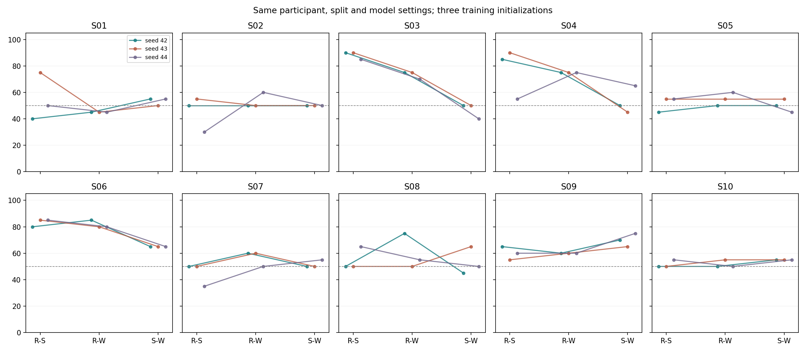

# 8-Channel EEG: Binary Classification and Power Differences

This project examines two questions: **can EEG distinguish the condition
labels, and what power differences are visible in the recorded signals?**
Ten participants contributed fifty retained trials per condition: Rest,
standing-up imagery (Stand), and walking imagery (Walk). Stand and Walk refer
to requested mental tasks, not actual movements.

Eight channels (FC3, FC4, C3, C4, Cz, CP3, CP4, CPz) were recorded at 256 Hz.
Each trial included 3 s fixation, a 2 s condition-specific visual cue, and
a 5 s task. Raw EEG and participant identifiers are not distributed.

## 1. Three Binary Classifiers

The same fixed **Filterbank CNN** is trained separately for **Rest-Stand,
Rest-Walk, and Stand-Walk**, within each participant. The model combines
filterbank and magnitude-spectrogram features through three CNN branches;
each classifier has two output classes.

### Participant-Level Accuracy

Each cell lists accuracy (%) for **training seeds 42 / 43 / 44**. All three
seeds use the same train/validation/test split: **60 / 20 / 20 original trials**
per comparison, with equal class counts. Test accuracy changes by five
percentage points per trial. All seeds are shown; no best seed is selected.

| Participant | Rest-Stand | Rest-Walk | Stand-Walk |
|---|---:|---:|---:|
| S01 | 40 / 75 / 50 | 45 / 45 / 45 | 55 / 50 / 55 |
| S02 | 50 / 55 / 30 | 50 / 50 / 60 | 50 / 50 / 50 |
| S03 | 90 / 90 / 85 | 75 / 75 / 70 | 50 / 50 / 40 |
| S04 | 85 / 90 / 55 | 75 / 75 / 75 | 50 / 45 / 65 |
| S05 | 45 / 55 / 55 | 50 / 55 / 60 | 50 / 55 / 45 |
| S06 | 80 / 85 / 85 | 85 / 80 / 80 | 65 / 65 / 65 |
| S07 | 50 / 50 / 35 | 60 / 60 / 50 | 50 / 50 / 55 |
| S08 | 50 / 50 / 65 | 75 / 50 / 55 | 45 / 65 / 50 |
| S09 | 65 / 55 / 60 | 60 / 60 / 60 | 70 / 65 / 75 |
| S10 | 50 / 50 / 55 | 50 / 55 / 50 | 55 / 55 / 55 |



Rest-versus-imagery prediction was more successful for some participants:
S03 reached **85-90%** for Rest-Stand and **70-75%** for Rest-Walk; S06 reached
**80-85%** for both comparisons. These are illustrative individual results,
not a cohort-wide accuracy. Other participants had lower scores or substantial
seed sensitivity. Stand-Walk scores were also variable: for example, S09
reached **65-75%**, while several participants remained near 50%.

[All 90 scores and correct counts](results/classification/participant_scores.csv)
| [Participant summaries](results/classification/participant_summary.csv)
| [Ten-participant summaries by seed](results/classification/group_summary.csv)

### Evaluation and Scope

Inputs cover task **0-5 s inclusive** (1,281 samples), following continuous
1-40 Hz filtering, a 60 Hz notch, and task-onset sample subtraction.
Five fixed filterbank bands and a magnitude STFT feed the model. There is
no per-trial T/CT/C input normalization or learned CSP filter in this profile.

The fixed setting uses dropout 0.3, AdamW learning rate 0.001, weight decay
0.0001, batch size 32, and validation-loss early stopping. Weights are selected
using **validation data**, saved, and then frozen for test prediction.
**Test answers are not used for fitting, checkpoint selection, or seed selection.**

These are exploratory results from the same recordings, with the model profile
highlighted after broader model comparisons. Repeating training seeds does not
add test trials or independent sessions. The results do not establish
new-person, new-day, or online BCI performance. Accuracy alone does not identify
the physiological source of the predictive signal.

[Model and runner](code/classification/)
| [Detailed methods and input contract](results/classification/METHODS.md)
| [Code and result verification](results/classification/VERIFICATION.md)

With authorized matching preprocessed trial arrays, run from the repository
root in an isolated Python 3.12 environment:

```bash
python -m pip install -r code/classification/requirements.txt
python -m unittest discover -s code/classification -p 'test_*.py'
python code/classification/run.py \
  --data /authorized/path/to/preprocessed_trials \
  --out cache/filterbank_new_run --device mps
```

The runner begins at the documented preprocessed-input boundary. Raw-data
extraction, private trial mappings, cached EEG, weights, and trial-level
predictions are not distributed. Exact cross-platform scores are not guaranteed.
The model was supplied with the project; Codex assisted adaptation, execution,
checking, and documentation.

## 2. EEG Power Differences and Feature Diagnostics

The Filterbank CNN asks whether labels can be predicted. This second topic
examines **how recorded power changes within and between conditions**, then
uses separate fixed linear classifiers to characterize condition information
across **time, frequency bands, and channel patterns**. The dB measurements
themselves do not use a classifier.

### Measurement

Band-limited power is estimated from equal-length **1 s windows**. Each
window is expressed relative to the same trial's pre-cue fixation baseline:

```text
change (dB) = 10 * log10(window power / fixation reference power)
```

The fixation reference is the geometric mean of two 1 s power estimates
from -4.5 to -2.5 s relative to task onset. The summaries below average the
four task windows from **1-5 s**, the two central channels **Cz and CPz**,
and fifty trials per condition, before averaging the ten participant means.
Positive dB means an increase from
fixation; negative dB means a decrease. These are averages of log power ratios,
not a ratio of power pooled across trials or participants.

Two references are compared: the recorded **earlobe reference** and
**8-channel common average reference (CAR)**, which subtracts the average
across the eight channels at each time point. This reference comparison is
not the T/CT/C input normalization used in other model profiles.

### Changes Within Each Condition

Values are mean changes from each condition's own fixation, in dB.

| Condition | 8-13 Hz, earlobe | 8-13 Hz, CAR | 13-30 Hz, earlobe | 13-30 Hz, CAR |
|---|---:|---:|---:|---:|
| Rest | +0.46 | +0.23 | -0.23 | -0.23 |
| Stand | +1.16 | +0.46 | -0.13 | -0.27 |
| Walk | +1.61 | +0.92 | -0.10 | -0.32 |

Rest also changes, so an imagery-versus-fixation change alone is not enough
to establish an imagery-specific effect. Comparing the changes between
conditions gives:

| Difference between fixation-relative changes | 8-13 Hz, earlobe | 8-13 Hz, CAR | 13-30 Hz, earlobe | 13-30 Hz, CAR |
|---|---:|---:|---:|---:|
| Stand minus Rest | +0.70 | +0.24 | +0.10 | -0.04 |
| Walk minus Rest | +1.16 | +0.70 | +0.13 | -0.10 |
| Walk minus Stand | +0.46 | +0.46 | +0.03 | -0.06 |

Each contrast is calculated within participant before averaging; the
Walk-minus-Stand row is derived from the participant condition summaries.
For 8-13 Hz, Walk exceeded Rest in **9/10 participants** with the earlobe
reference and **8/10** with CAR. The difference was positive in both the
first and last 25 trials in **8/10** and **7/10**, respectively. Stand-minus-Rest
was more reference-sensitive: **8/10** positive with earlobe, **4/10** with CAR.
The 13-30 Hz group mean contrasts were smaller than the 8-13 Hz contrasts;
this does not rule out participant-specific or spatial beta-band information.


The curves show all five 1 s task bins and the first cue bin. Shaded bands
are participant-level 95% t intervals. The 1-5 s summary window was chosen
after inspecting the time course; these are descriptive results, not
confirmatory significance tests.

[Participant power summaries](results/reanalysis/within_class_late_participant.csv)
| [Group power summaries](results/reanalysis/within_class_late_group.csv)
| [Full time-course summaries](results/reanalysis/within_class_group.csv)
| [Power calculation](code/reanalysis/within_class_checks.py)
| [Task-window aggregation](code/reanalysis/within_class_late_summary.py)

### Time, Frequency Band, and Spatial Pattern

These auxiliary analyses ask **where condition information appears in the
recorded features**. They are not an explanation of the CNN's internal
decisions or replacement estimates of its accuracy. All values below are
**mean balanced accuracy (%) across ten participants**, with 50% as the
chance reference. Balanced accuracy averages recall for the two labels.

Each probe uses a fixed logistic regression with C=0.3. Feature standardization
and classifier fitting occur only within the training fold. The probes use
their own cross-validation folds across retained trials, **not the CNN's
fixed twenty-trial test set**, and are not independent confirmation of its
scores. The values are taken from the saved aggregate tables linked below.

#### Time: When Is Condition Information Present?

Eight-channel 8-13 and 13-30 Hz log power is compared across stages, using
five contiguous held-out trial blocks within each participant. The fixation,
cue, early-task, and late-task stages each average two matched 1 s estimates.
The pooled task 1-5 s feature averages four. Task-minus-fixation subtracts
each trial's own fixation log power before classification.

| Contrast | Reference | Fixation -4.5 to -2.5 s | Cue -2 to 0 s | Task 0-2 s | Task 3-5 s | Task 1-5 s | Task 1-5 s minus fixation |
|---|---|---:|---:|---:|---:|---:|---:|
| Rest-Stand | Earlobe | 46.8 | 52.3 | 57.5 | 60.8 | 62.5 | 56.5 |
| Rest-Stand | CAR | 48.4 | 51.8 | 60.0 | 59.1 | 63.4 | 58.2 |
| Rest-Walk | Earlobe | 49.7 | 55.0 | 59.4 | 55.8 | 59.1 | 56.5 |
| Rest-Walk | CAR | 48.6 | 51.1 | 60.1 | 57.4 | 62.8 | 61.0 |

Before-cue group means were close to 50%; task features were more predictive
under these probes. Equal-duration early and late task windows do **not** show
a consistent late advantage across contrasts and references. The pooled 4 s
window averages more data, so its higher scores cannot be called a late-only
effect. Subtracting fixation still leaves some predictive information,
especially for Rest-Walk under CAR, but does not exclude delayed cue effects
or ocular/muscle contributions.

[Stage results, earlobe](results/reanalysis/rest_mi_stage_group.csv)
| [Stage results, CAR](results/reanalysis/rest_mi_stage_car_group.csv)
| [Participant scores, earlobe](results/reanalysis/rest_mi_stage_participant.csv)
| [Participant scores, CAR](results/reanalysis/rest_mi_stage_car_participant.csv)
| [Stage feature and evaluation code](code/reanalysis/rest_mi_stage_diagnostics.py)

#### Frequency Band: Which Band Carries Condition Information?

Using the same task 1-5 s windows and contiguous-fold evaluation, the probes
are fitted separately to the eight channel powers in each band:

| Contrast | Reference | 8-13 Hz only | 13-30 Hz only |
|---|---|---:|---:|
| Rest-Stand | Earlobe | 57.0 | 61.3 |
| Rest-Stand | CAR | 57.7 | 60.5 |
| Rest-Walk | Earlobe | 61.0 | 58.4 |
| Rest-Walk | CAR | 60.7 | 57.0 |

The beta-band probe was more predictive for Rest-Stand, while the 8-13 Hz
probe was more predictive for Rest-Walk, in both references. These are
descriptions of label information in band-power features, **not estimates of
each band's physiological contribution** or proof of a motor-cortical source.
The source tables and calculation code are the same as for the time probes.

#### Spatial Pattern: Overall Power or Relative Channel Distribution?

A separate decomposition uses task **0.5-4.5 s** power with the earlobe
reference. For each trial and band, the eight-channel mean of log power gives
the global level; subtracting that mean from each channel's log power gives the relative
spatial pattern. Both bands are retained. This channel-pattern transformation
is not CAR rereferencing: it operates on log-power features, not time-domain
voltages.

Fixed, class-balanced logistic probes use five repetitions of stratified
five-fold cross-validation. **Pooled imagery combines Stand and Walk into
one label** (100 imagery trials versus 50 Rest trials). It is an auxiliary
binary contrast for feature characterization, not one of the three primary
Filterbank comparisons.

| Feature set | Rest vs pooled imagery | Stand-Walk |
|---|---:|---:|
| Global band levels | 59.7 | 51.5 |
| Relative channel pattern | 61.6 | 50.6 |
| Both combined | 63.2 | 50.7 |

Both global levels and relative channel patterns carry some information for
Rest versus pooled imagery in this evaluation. Stand-Walk group means remain
close to 50% for all three feature sets; this is not proof of equivalence to chance
or an upper limit on another model. The feature sets are related transformations
of the same powers, not independent physiological sources. Neither this
decomposition nor the band probes identify which features the CNN used.
Different windows, power estimates, and validation folds also prevent a direct
ranking of these scores against the time/band probes or the CNN.

[Feature-decomposition group scores](results/reanalysis/physiology_pattern_group.csv)
| [Participant scores](results/reanalysis/physiology_pattern_participant.csv)
| [Feature-decomposition code](code/reanalysis/physiology_pattern_ablation.py)
| [Cross-validation helper](code/reanalysis/contrast_logic_checks.py)
| [Task-power feature extraction](code/reanalysis/reanalyse_cached_eeg.py)

All probes are exploratory comparisons of the same recordings. Multiple
windows and feature sets were inspected without confirmatory significance
tests. Continuous offline filtering and within-recording splits do not remove
all temporal dependence or establish new-session performance.

### Interpretation

The clearest group pattern is an **8-13 Hz increase in Walk relative to Rest**,
not a consistent decrease across the imagery conditions. A positive
Walk-minus-Stand mean is a descriptive difference, not evidence that this
single feature reliably separates individual trials.

These measurements support a **condition-associated scalp EEG power
difference**, not an identified motor-imagery-specific cortical response.
The 8-13 Hz band is not treated as confirmed sensorimotor mu activity merely
because of its frequency. Condition-specific cues, attention, eye or muscle
activity, and imagery performance cannot be separated without the missing
EOG, EMG, gaze, and trial-level compliance measurements.

The dB summaries use task 1-5 s and all retained condition trials; the CNN uses
task 0-5 s and a held-out classification split. The linear probes use separately
specified windows and cross-validation folds. The power summaries and probes
describe differences and predictive features in the recordings; they do **not**
establish which features the CNN used or why a particular participant was
classified well.
