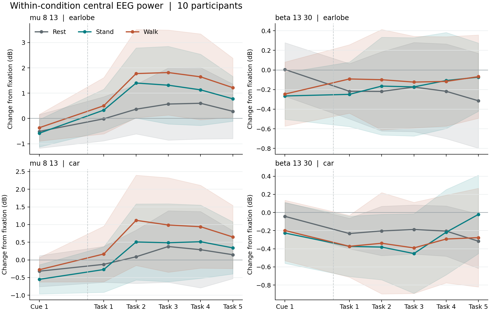

# Standing and walking motor imagery with 8-channel EEG

Ten participants performed 50 retained trials each of rest, standing-up imagery, and walking imagery. Each trial had 3 s of fixation, a 2 s condition-specific visual cue, and a 5 s task period. EEG was recorded at 256 Hz from eight channels around the sensorimotor scalp. This repository contains the original exploratory analysis and a later, explicitly post-hoc reanalysis of the same recordings.

The question was whether the recorded EEG could distinguish standing from walking imagery. **Rest-versus-imagery condition labels were partly predictable:** the original saved nested-CV scores averaged 65.8% for Rest–Stand and 64.5% for Rest–Walk. Stand–Walk prediction was weaker in the selection-separated evaluations. These are condition-label results, not proof that the classifier decoded motor-imagery-specific cortical activity.

**October 12 historical-score audit:** participant-specific best test scores across 7 normalizations × 18 MD2DEEGNet settings averaged **82.0% Rest–Stand, 79.0% Rest–Walk, and 78.5% Stand–Walk**. All three are descriptive, **test-selected maxima**, not independent generalization estimates. The three contrasts are compared under the same selection rule, with selection-separated evaluations reported in a separate table. No new neural-network training was performed for this three-contrast audit.

**October 9 recheck, published October 10:** a bounded eight-channel temporal/covariance search found weak Stand–Walk label information, but not stable high-accuracy decoding or a verified motor-specific source. The model-selection procedure averaged **52.1%** across five random splits, versus **51.6%** with purged time blocks and **48.0%** in uncalibrated leave-one-person-out evaluation. A post-hoc maximum-over-candidates test gave **p=.015**, with a narrower interpretation explained in section 4. These are new analyses of the same recordings, not a new sample or a replacement for the original saved-score audit.

[한국어 상세 보고서](results/reanalysis/stand_walk_2026_10_09/REPORT_ko.md) · [Protocol and hypotheses](results/reanalysis/stand_walk_2026_10_09/protocol_and_hypotheses.md) · [Source-claim verification](results/reanalysis/stand_walk_2026_10_09/source_verification.md)

## 1. Classification results

### Historical MD2DEEGNet exploration: all three binary contrasts

For each participant and contrast, the audit takes the largest recorded fused-head test accuracy from **126 candidates**, then averages those ten maxima. It is a mean, but **not** the mean of all 126 candidates and **not** one common configuration evaluated across people. Exactly 210 saved binary log files and 3,780 configuration rows were checked (10 people × 3 contrasts × 7 × 18).

| Contrast | Mean of participant-specific best-of-126 test scores | Participant range | Selection used test scores? |
|---|---:|---:|---|
| Rest vs Stand | **82.0%** | 70.0–100.0% | Yes |
| Rest vs Walk | **79.0%** | 65.0–90.0% | Yes |
| Stand vs Walk | **78.5%** | 70.0–90.0% | Yes |

These high scores are present in the historical logs; they are not a new independently validated result. Selecting settings on the test set makes that set part of the search, so its maximum can be optimistic for new trials. The current original source explicitly selects by fused **test** accuracy. The exact source version, preprocessing and random-number state that generated the historical folder have not been fully reconstructed. The audit checks the recorded scores, not that historical execution provenance or a fully rerun 126-candidate search.

The three maxima do not show a clear Rest–Walk versus Stand–Walk separation. Differences from the evaluations below also involve models, preprocessing, trial selection and splits; the entire numerical gap cannot be attributed to test selection alone.

[Participant-specific selected scores](results/reanalysis/md2d_grid_2026_10_12/historical_selected.csv) · [All anonymized candidate scores](results/reanalysis/md2d_grid_2026_10_12/historical_grid_anonymized.csv) · [Aggregation and scope](results/reanalysis/md2d_grid_2026_10_12/REPORT_ko.md)

### Selection-separated evaluations

The original nested cross-validation results below were **recalculated from saved scores**, not obtained by rerunning the entire original model search. The interval is across the ten participant scores and does not account for analysis choices made on these data.

| Contrast | Mean accuracy | Participant-level 95% t interval | Chance |
|---|---:|---:|---:|
| Rest vs Stand | 65.8% | 57.1–74.5% | 50% |
| Rest vs Walk | 64.5% | 57.1–71.9% | 50% |
| Stand vs Walk | 53.1% | 47.5–58.7% | 50% |
| Three classes | 45.8% | 39.5–52.0% | 33.3% |

[Saved-score audit](results/reanalysis/nested_score_summary.csv) · [Original participant scores](results/final_scores.csv)

A separate fixed analysis used 8–30 Hz log power from all eight channels, a fixed logistic regression, and repeated within-participant five-fold cross-validation. Its mean balanced accuracy was **60.6%** for Rest–Stand, **59.5%** for Rest–Walk, and **51.6%** for Stand–Walk. These values are from a different feature and evaluation procedure, so they are a qualitative check of the original ordering rather than a replication of the nested estimates. The Stand–Walk results do not establish equivalence to chance or an upper limit on what another measurement or model could recover.

[Fixed-model participant scores](results/reanalysis/fixed_model_scores.csv)

**Reading these results together:** the selection-separated procedures support partial Rest-versus-imagery label prediction and weak Stand–Walk prediction under the evaluated conditions. The historical maximum table documents the broader search, but does not establish robust 79–82% decoding for any contrast. Neither table identifies the physiological source or proves an information ceiling.

## 2. Does each condition show an EEG change?

We compared equal-length 1 s power estimates during fixation with the task bins from 1–5 s after task onset. These are participant means for **8–13 Hz at Cz and CPz**:

| Condition | Change from its own fixation, earlobe | Change from its own fixation, CAR |
|---|---:|---:|
| Rest | +0.46 dB | +0.23 dB |
| Stand | +1.16 dB | +0.46 dB |
| Walk | +1.61 dB | +0.92 dB |

Subtracting the rest change within each participant gives the following contrasts. The 1–5 s summary was selected after viewing the time course, so its intervals are descriptive and do not provide confirmatory significance tests.

| Extra change relative to Rest | Earlobe reference, dB (95% interval) | 8-channel CAR, dB (95% interval) | Participants with a positive value, earlobe/CAR |
|---|---:|---:|---:|
| Stand | +0.70 (+0.05, +1.35) | +0.24 (−0.43, +0.90) | 8/10, 4/10 |
| Walk | +1.16 (+0.35, +1.97) | +0.70 (+0.01, +1.38) | 9/10, 8/10 |

The walking condition has the more consistent rest-exceeding increase. Its direction persisted in both trial halves for 8/10 participants with the earlobe reference and 7/10 with CAR. Rest itself also changed over the task period, and the standing result was reference-sensitive. The walking CAR interval is close to zero at its lower bound. The repeated direction across halves supports a **within-recording, task-associated scalp power change**; it does not identify the source of the 8–13 Hz signal as sensorimotor cortex or verify imagery performance.



[Time-course summaries](results/reanalysis/within_class_group.csv) · [Selected 1–5 s summaries](results/reanalysis/within_class_late_group.csv)

## 3. What separates Rest from the imagery conditions?

For each participant, a fixed classifier used the 8–13 and 13–30 Hz log power of eight channels. The table gives mean **balanced accuracy** with contiguous five-fold validation. The first four windows each cover 2 s; the pooled 1–5 s window covers 4 s and therefore averages more data. Chance is 50%.

| Contrast | Reference | Before cue | Cue | Task 0–2 s | Task 3–5 s | Task 1–5 s | Task 1–5 s minus same-trial fixation |
|---|---|---:|---:|---:|---:|---:|---:|
| Rest–Stand | Earlobe | 46.8% | 52.3% | 57.5% | 60.8% | 62.5% | 56.5% |
| Rest–Stand | CAR | 48.4% | 51.8% | 60.0% | 59.1% | 63.4% | 58.2% |
| Rest–Walk | Earlobe | 49.7% | 55.0% | 59.4% | 55.8% | 59.1% | 56.5% |
| Rest–Walk | CAR | 48.6% | 51.1% | 60.1% | 57.4% | 62.8% | 61.0% |

Before the cue, future condition labels were not predictably represented by these features at group level. During the task, both references carried label information. Comparing equal-duration task windows does **not** show a consistent advantage for the end of the trial; the 4 s pooled window's higher score should not be described as a late-only effect. Removing same-trial fixation power still left some information, especially for Rest–Walk under CAR. The cue could also have delayed effects that these comparisons cannot exclude.

In the pooled 1–5 s window, beta-only features reached 61.3%/60.5% (earlobe/CAR) for Rest–Stand; 8–13 Hz-only features reached 61.0%/60.7% for Rest–Walk. A separate decomposition of 0.5–4.5 s power found Rest–pooled-imagery information in both global band levels (59.7%) and relative channel pattern (61.6%). These are **predictive descriptions of recorded signals**, not estimates of the physiological contribution of each source. The walking 8–13 Hz increase above cannot by itself explain the original Rest–Walk classifier: the first 2 s of the task also carried information.

[Stage-by-stage results, earlobe](results/reanalysis/rest_mi_stage_group.csv) · [Stage-by-stage results, CAR](results/reanalysis/rest_mi_stage_car_group.csv) · [Power-pattern decomposition](results/reanalysis/physiology_pattern_group.csv)

## 4. October 9 Stand–Walk recheck

### What was tested?

All eight channels (FC3, FC4, C3, C4, Cz, CP3, CP4, CPz) were used across four bands: 4–8, 8–13, 13–20, and 20–30 Hz. Features included mean log power, fixation-relative changes, 17-bin temporal trajectories, phase/sign-tolerant temporal summaries, and shrinkage covariance with tangent-space or CSP models. All learned scaling, CSP and tangent references were fitted inside training folds.

The handover protocol cites Ma et al. (2023), whose compound-limb classes were **left leg + right arm versus right leg + left arm**. Our **standing-up versus two-step walking** comparison is different. The walking instructions specified two alternating steps, but actual step timing, starting side and repetition were not measured. Free change-point magnitude, variability, crossings and slow modulation were therefore examined without assuming a switch exactly at 2.5 s. Earlier Claude code had already examined several of these phase-free summaries; this is an expanded reevaluation, not their first use.

### Generalization, not just the best model

| Stand–Walk evaluation | Mean accuracy | Participant-level descriptive 95% t interval |
|---|---:|---:|
| Nested selection, initial random split | 52.5% | 47.6–57.4% |
| Nested selection, average of five random seeds | **52.1%** | 47.5–56.7% |
| Nested selection, purged contiguous blocks | **51.6%** | 48.0–55.2% |
| Uncalibrated participant-exclusive LOSO | **48.0%** | 44.0–52.0% |
| Fixed trajectory logistic model, five-seed average | 55.3% | 51.6–59.0% |

The fixed trajectory model reached **55.9%** on the initial split. It was noticed after inspecting the candidate scores, so neither 55.9% nor its five-seed average is an independently validated winner accuracy. Nested selection evaluates the procedure that chooses a model using only each outer training set. The fixed-model and nested numbers answer different questions. All repeats were averaged within person before summarizing ten participants; five seeds do not create fifty independent people.

Time-block evaluation removes the test block and one adjacent selected Stand/Walk trial on each side from training. It is not forward-only prediction or a new-day test. LOSO also separates participants during inner selection. Its training sets overlap across folds, limiting a simple independent-sample reading of the interval.

[Within-person summaries](results/reanalysis/stand_walk_2026_10_09/within_person_summary.csv) · [Five-seed summaries](results/reanalysis/stand_walk_2026_10_09/split_stability_summary.csv) · [LOSO summaries](results/reanalysis/stand_walk_2026_10_09/cross_person_summary.csv)

### Is any Stand–Walk label information detectable?

A post-hoc blocked-label test reran **all 23 fixed candidates × both evaluation modes** in each of 199 permutations and retained the largest participant-mean score. The observed maximum was **55.9%**; the null maximum averaged **53.18%**, with a 95th percentile of **55.31%**. Two permutations equaled or exceeded the observed value, giving the +1-corrected **p=(2+1)/(199+1)=.015**.

This supports weak condition-label information under exchangeability within the defined chronological blocks of at most ten selected Stand/Walk trials per run. It does **not** test the nested-selection algorithm, correct all historical searches, validate the winning accuracy on new data, or identify a motor-imagery-specific source. The finite 199-permutation calculation also has Monte Carlo uncertainty.

[Permutation result and scope](results/reanalysis/stand_walk_2026_10_09/blocked_search_test.json) · [All null maxima](results/reanalysis/stand_walk_2026_10_09/blocked_search_permutations.csv)

### Does the signal show the hypothesized alternation?

The later central 8–13 Hz increases in section 2 were reproduced with matched power estimates. The mean 1–5 s fixation-relative change at Cz/CPz was negative in only 3/10 participants per imagery condition with the earlobe reference and 4/10 with CAR. This does not establish continuously sustained suppression in those participants or rule out a transient early decrease followed by an increase.

Temporal laterality did not yield a robust walking-alternation signature. For example, the earlobe 13–20 Hz free change-point magnitude was larger for Walk, but the direction did not persist under CAR and was positive in both trial halves in only 3/10 participants. **Two CAR signal metrics did survive parametric t-test Holm correction** over 480 metrics per reference/contrast: CPz mu-band slow modulation was larger for Walk (adjusted p=.0488), and pooled low-beta laterality range was smaller (adjusted p=.00724). These exploratory differences are not the hypothesized larger walking alternation and do not identify an MI-specific source.

No exact sign-flip test survived the same Holm family, but this cannot serve as evidence against an effect: with ten people, the smallest two-sided exact p is 2/1024, already above the first Holm threshold .05/480. The October 10 publication audit corrected the earlier local report's overbroad statement that no signal metric survived any correction. Non-detection or a method-sensitive detection is not proof that all neural differences are absent.

Matched channel comparisons did not show a clear gain from eight-channel power over Cz/CPz alone. Limiting extreme amplitudes in the same 8–30 Hz covariance model gave 52.9%→52.5% (random) and 52.8%→52.5% (time blocks); this is not validated ocular/muscle artifact removal. A 30–45/8–30 Hz ratio was also described, not treated as an EMG diagnosis.

Additional LOSO sensitivities reached 49.5% with per-trial covariance trace normalization and 52.4% with session whitening. Whitening used **all 150 unlabeled trials of the held-out participant**, so it is transductive offline calibration, not uncalibrated prediction for a completely unseen person.

[Signal summaries](results/reanalysis/stand_walk_2026_10_09/signal_summary.csv) · [Matched controls](results/reanalysis/stand_walk_2026_10_09/matched_controls_summary.csv) · [Calibration scope](results/reanalysis/stand_walk_2026_10_09/alignment_scope.json)

## 5. Interpretation and limits

Condition labels changed together with the visual cue and the requested mental task. No simultaneous EOG, EMG, gaze, or trial-level imagery-compliance measure is available. Cortical motor imagery, visual attention, other mental state changes, and ocular or muscle contributions therefore cannot be separated causally in these recordings. The data support a **condition-associated EEG power difference** and partial Rest-versus-imagery label prediction; they do not establish why the physiological signal arose or why Stand–Walk prediction was weak in selection-separated evaluations. “No physiological signal” and “verified pure MI decoding” would both overstate what was learned.

The original ERD figures in the top-level `results/` directory should not be used as evidence for sustained 8–13 Hz suppression. The estimator used there gave **−2.32 dB for a stationary simulated signal** with no task change. A comparison using matched 1 s power estimates instead found a later 8–13 Hz increase, most consistently in Walk. Likewise, exploratory channel curves, model sweeps, execution controls, and artifact-removal attempts do not establish a device-wide information ceiling, a peripheral cause, or absence of neural differences.

This reanalysis was developed after inspecting the original results. The participant intervals, window comparisons, and alternative models are descriptive; they are not independent validation. A follow-up study would need balanced cues, a matched nonmotor control, direct artifact measurements, trial-level performance checks, and a separately held-out sample or session to test a motor-specific explanation.

[Stationary-signal estimator check](results/reanalysis/erd_estimator_stationary_null.json)

## Reproduce the reanalysis

### October 12 historical grid-log audit

The [audit script](code/reanalysis/audit_md2d_grid.py) uses only the Python standard library and does not load EEG arrays. Authorized historical logs and cache filenames are required to reproduce the pseudonym mapping; neither is distributed. The public anonymized candidate CSV is sufficient to recalculate all three participant-specific maxima and means. This audit does not retrain networks or reproduce the nested-CV analyses.

```bash
python -m unittest discover -s code/reanalysis -p test_md2d_grid_audit.py
python code/reanalysis/audit_md2d_grid.py \
  --logs /authorized/path/to/historical_grid_logs \
  --cache /authorized/path/to/continuous_cache \
  --out cache/md2d_grid_audit
```

### October 9 code and publication scope

The six new scripts are in [code/reanalysis/stand_walk_2026_10_09](code/reanalysis/stand_walk_2026_10_09/); curated results, the Korean report, analysis-plan history and literature verification are in [results/reanalysis/stand_walk_2026_10_09](results/reanalysis/stand_walk_2026_10_09/). Original code and results remain unchanged. Raw EEG, continuous caches, trial-level predictions/features, input hashes and local dependency folders are not published.

Use an isolated Python 3.12 environment with the [recorded package versions](code/reanalysis/stand_walk_2026_10_09/requirements.txt). The cache must first be built with authorized data access as described below. Generated files default to ignored `cache/stand_walk_recheck/`, not the curated public-results folder. `EEG_CACHE_DIR` and `EEG_RECHECK_WORK` can override the two locations.

```bash
python -m pip install -r code/reanalysis/stand_walk_2026_10_09/requirements.txt
export EEG_CACHE_DIR=/authorized/path/to/continuous_cache
export EEG_RECHECK_WORK=cache/stand_walk_recheck
python code/reanalysis/stand_walk_2026_10_09/recheck_stand_walk.py --stage all
python code/reanalysis/stand_walk_2026_10_09/check_split_stability.py
python code/reanalysis/stand_walk_2026_10_09/check_search_optimism.py --permutations 199 --workers 4
python code/reanalysis/stand_walk_2026_10_09/diagnostics_and_controls.py
python code/reanalysis/stand_walk_2026_10_09/check_cross_subject_alignment.py
python code/reanalysis/stand_walk_2026_10_09/check_high_band.py
```

`--stage test` runs four synthetic/boundary checks without recordings. They test implementation properties, not sensitivity to real imagined steps. The published manifests retain the October 9 computation source hash; the portable release changes paths and removes a local diagnostic-helper dependency. [Release verification and output inventory](results/reanalysis/stand_walk_2026_10_09/RELEASE.md) distinguish those versions.

### Earlier reanalysis

The new scripts are in `code/reanalysis/`; their selected anonymized outputs are in `results/reanalysis/`. The original scripts and outputs remain in the top-level `code/` and `results/` directories as a record of the exploratory work. Interpret older figures and logs using the revised limits above.

With authorized access to the recordings, set `STEAM_DATA_DIR` to the raw-data directory and build the continuous cache using `code/steam_io.py`. The reanalysis scripts take that cache as input. Python 3.11 with NumPy, SciPy, pandas, scikit-learn, matplotlib, MNE, and pyxdf covers the scripts below.

```bash
export STEAM_DATA_DIR=/authorized/path/to/BBRaw
PYTHONPATH=code python -c 'import steam_io; steam_io.build_cache()'
python code/reanalysis/audit_existing_results.py --source . --out results/reanalysis
python code/reanalysis/check_xdf_cache.py --raw "$STEAM_DATA_DIR" --cache cache --out results/reanalysis
python code/reanalysis/reanalyse_cached_eeg.py --cache cache --out results/reanalysis
python code/reanalysis/contrast_logic_checks.py --cache cache --out results/reanalysis
python code/reanalysis/physiology_pattern_ablation.py --cache cache --out results/reanalysis
python code/reanalysis/within_class_checks.py --cache cache --out results/reanalysis
python code/reanalysis/within_class_late_summary.py --results results/reanalysis
python code/reanalysis/within_class_figure.py --results results/reanalysis
python code/reanalysis/rest_mi_stage_diagnostics.py --cache cache --out results/reanalysis --reference ear
python code/reanalysis/rest_mi_stage_diagnostics.py --cache cache --out results/reanalysis --reference car
python code/reanalysis/erd_estimator_null.py --out results/reanalysis
```

`check_xdf_cache.py` requires the original XDF files and writes local file hashes; those hashes are not included in this repository. The cache and raw recordings are not distributed. Public result tables use pseudonyms S01–S10 and do not contain trial-level signals or direct identifiers. The published files are sufficient to inspect the numerical summaries; full signal-level reproduction requires separately authorized data access.
