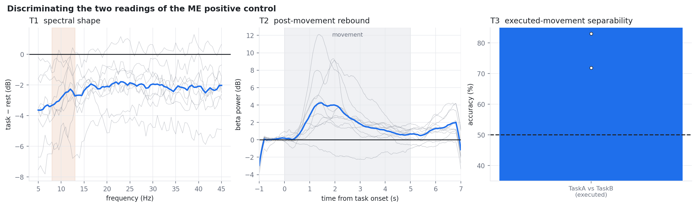
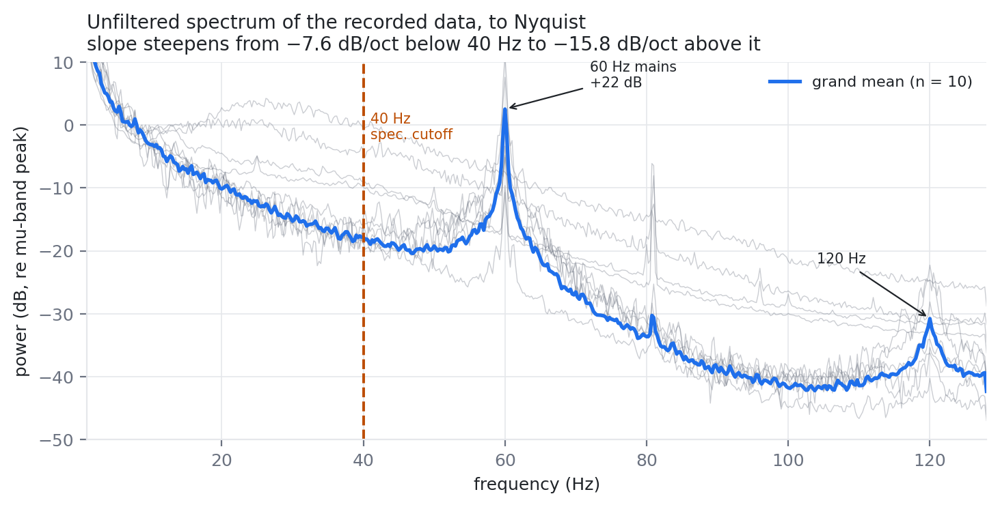
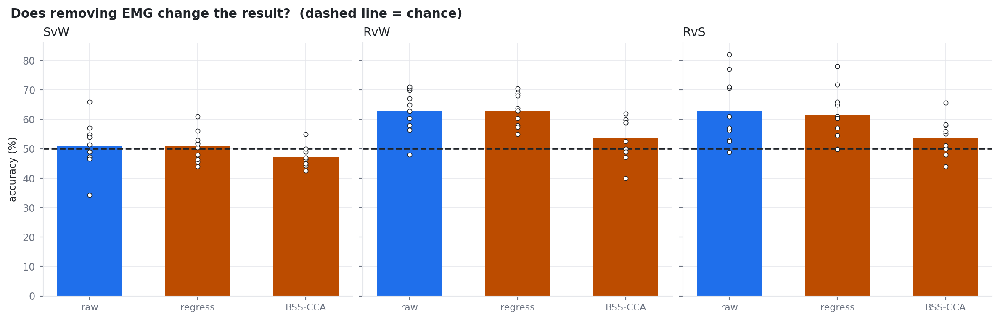

# Lower-limb motor imagery on an 8-channel wearable EEG montage

**Can a consumer-grade 8-channel EEG headset tell apart *rest*, *standing-up* and *walking* motor imagery?**
Ten participants, 50 trials per class, Bitbrain Versatile at 256 Hz.

**Answer: partly.** Rest is separable from imagery. **Standing and walking imagery are not
separable from each other**, and this repository is mostly about establishing that carefully
rather than merely reporting it.


---

## 1. Headline numbers

Nested cross-validation, participant as the unit of analysis (*n* = 10).

| Contrast | Accuracy | Chance | 95 % CI | *t*(9) | Individually significant |
|---|---|---|---|---|---|
| Rest vs Stand | 65.8 ± 12.1 % | 50 | [57.1, 74.5] | +4.11, *p* = .0026 | 5 / 10 |
| Rest vs Walk | 64.5 ± 10.3 % | 50 | [57.1, 71.9] | +4.42, *p* = .0017 | 8 / 10 |
| **Stand vs Walk** | **53.1 ± 7.9 %** | 50 | **[47.5, 58.7]** | **+1.24, *p* = .246** | **1 / 10** |
| Three-class | 45.8 ± 8.7 % | 33 | [39.5, 52.0] | +4.51, *p* = .0015 | 8 / 10 |

The Stand-vs-Walk confidence interval **contains chance**. All three-class error mass sits in
the Stand–Walk block — the three-class problem and the Stand-vs-Walk problem are the same problem.

**The negative is bounded, not merely unachieved.** Four independent routes agree:

| Bound | Measurement | Result |
|---|---|---|
| Exhaustive search | 840 configs/participant, scored optimistically on the reported folds | 7/10 still below 70 % |
| Learning curve | +5.5 points per decade of trials | doubling a session buys **+1.7 points** |
| Channel curve | greedy forward selection | saturates at **3 electrodes** |
| Topography | between-class distance ÷ own noise floor | **1.07–1.12** (*p* > .46) |

Formally: Stand-vs-Walk is significantly *below* the ~70 % usability threshold
(one-sided *t*(9) = −6.78, *p* = 4.1 × 10⁻⁵), while TOST does **not** support equivalence to
chance at ±5 points (*p* = .232) — only at ±8 (*p* = .040). The defensible statement is bounded
on both sides.

---

## 2. Why it fails — and how we know it is not the equipment

### The montage is spatially saturated

| Metric | Value |
|---|---|
| Components for 95 % of variance | **3.4** of 8 |
| Effective dimensionality (participation ratio) | **1.49** |
| Mean inter-electrode correlation | **0.783** |

Eight electrodes span roughly **one and a half** effective spatial dimensions. Two independent
measurements — classification accuracy (channel curve) and the covariance eigenvalue spectrum —
agree on this.

This matters beyond the null: it is also why decomposition-based artifact removal is unavailable
here (§4).

### The recording chain works

A motor-execution positive control on the same electrodes, amplifier and decoder separates two
**executed** movements at **91.1 %** in every participant (range 71.9–100, *p* < .0001). Nothing
in this repository can be blamed on a broken pipeline.



But that separation is **peripheral, not cortical.** Genuine motor execution produces beta
desynchronisation *during* movement and a rebound *after* offset; muscle stops when movement
stops rather than overshooting. We measured the reverse — beta rises **+2.70 dB** during movement
(*p* = .0046) and **falls 1.67 dB** afterwards (*p* = .0119). A weak cortical component does exist:
a mu-specific trough **1.56 dB** below the broadband shift (*p* = .0032).

### One mechanism explains every accuracy in this repo

> **This montage is dominated by peripheral and global signals wherever they exist, and its
> cortical component is weak.**

| Result | Peripheral/global signal available | Accuracy |
|---|---|---|
| Executed movement A vs B | large — limb and trunk EMG, motion | **91.1 %** |
| Rest vs imagery | moderate — a global visual-attention difference | 64–66 % |
| One participant, Stand vs Walk | moderate — broadband arousal and muscle tone | 67.0 % |
| Stand vs Walk, group | **none** — both classes motionless and visually identical | **53.1 %** |

The ordering of accuracies is the ordering of the *peripheral* signal, not of the cortical
difference the paradigm intended to elicit. Three of those four rows are statistically
significant. **None of them decodes what the task was designed to elicit.**

---

## 3. Traps — read this before you touch the data

Every one of these silently corrupted a result at some point during this project.

### 3.1 The unit of analysis is the participant, not the trial

Pooling ~1000 trials across ten people and running a binomial test treats correlated
observations as independent:

```
Stand vs Walk, trials pooled   →  p = .026    "significant"
Stand vs Walk, participant t   →  p = .246    not significant
```

The conclusion flips. Use the participant-level test.

### 3.2 The cue window leaks the class label

Each trial is `3 s fixation → 2 s class-specific cue → 5 s imagery`. The cue is a **different
picture per class**. Any epoch reaching back before imagery onset imports it:

```
cue period alone decodes at 52–56 %
```

The epochs here are `+0.5 … +4.5 s` relative to imagery onset — the 0.5 s offset also skips the
auditory evoked response to the start beep.

### 3.3 Trial rejection differs by band — never load two epoch sets separately

```python
ep   = sio.get_epochs(date, subj, l_freq=8,  h_freq=30)   # 144 trials
wide = sio.get_epochs(date, subj, l_freq=1,  h_freq=45)   # 150 trials  ← desynchronised
```

Use `sio.get_bank(...)`, which decides rejection once on a broad band and applies the *same*
mask to every sub-band.

### 3.4 Keep-rules are keyed by recording date

Three participants have partial runs that need explicit trial selection. Those rules are keyed
by **date alone** (dates are unique per participant). Mis-keying them silently changes the trial
count — 147 became 178 in one such accident, which would have shifted every downstream number.

### 3.5 The amplifier stops at 40 Hz

The 8-channel configuration has an analogue bandwidth of **DC–40 Hz, third order** (the 16/32/64
channel versions of the same system reach 70 Hz). This is *not* in the manufacturer's reference
guide; we confirmed it from the recordings:

```
20 → 40 Hz :  −7.6 dB/octave     ← close to the 1/f falloff of EEG alone
40 → 80 Hz : −15.8 dB/octave     ← plus the instrument's third-order roll-off
```



Any band reaching past 40 Hz is measured through attenuation. **Sampling rate does not tell you
the bandwidth** — the 16-channel model samples at the same 256 Hz and cuts at 70 Hz.

### 3.6 The 60 Hz notch is load-bearing

In the unfiltered recordings the mains line sits **22 dB above its spectral neighbours** and
2.5 dB above the mu-band peak itself. The 120 Hz harmonic survives too. Do not assume the
analogue roll-off has already removed it.

### 3.7 EMG lives inside the analysis band

Goncharova *et al.* measure frontalis EMG amplitude as *"greatest at 20–30 Hz frontally"* and
name a 20–30 Hz **EMG beta rhythm**. Our analysis band is 8–30 Hz.

**Accuracy inside 8–30 Hz is therefore not evidence of a cortical origin.** One participant
reached 67.0 % on Stand vs Walk (permutation *p* = .004, Holm *p* = .040) and six checks rejected
it — peak *r*² at 36 Hz, spatially flat topography, equal decoding from delta/theta where no
sensorimotor rhythm exists, and collapse from 76.2 % to 60.0 % across a 46-minute gap **with the
cap never removed**.

### 3.8 Class-to-marker assignment is an external authority

The map used throughout is `2 = Rest, 5 = Stand, 8 = Walk`, taken from the experimenters'
protocol script. An independent reading of the within-trial marker ordering is possible; every
per-class statement is conditional on this assignment. Do not re-derive it from marker order.

---

## 4. What was tried and did not work

Roughly ten distinct hypotheses were tested against Stand-vs-Walk, each after the previous one
failed. Listing them so nobody repeats the search:

| Attempt | Outcome |
|---|---|
| 840-configuration grid (15 windows × 7 bands × 2 refs × 4 pipelines) | mean 68.4 % under an optimistic scoring procedure |
| 19 decoding pipelines incl. FBCSP, MDM/FgMDM, EEGNet-8,2 | none significantly better (corrected *t*, all *p* ≥ .247) |
| Late-window divergence (standing is a ~2 s transition) | 52.4 %, no better than the full period |
| Gait-cadence envelope modulation | fails |
| Within-trial alternating laterality — 6 timing-free statistics × 2 bands | 1 of 12 survives Holm, **in the direction opposite to the prediction** |
| Peak-locked laterality (label-free peak selection) | +1.02 dB, 56.1 % decoding, *p* = .0084 — does not clear Bonferroni for ~10 hypotheses |
| Physiologically constrained classifiers (foot-area Laplacian, individual SMR bands, medial-only CSP) | no improvement, all *p* > .37 |
| EMG removal by nuisance regression | **−0.12 points** (*p* = .938) — the null is information-limited, not noise-limited |
| EMG removal by BSS-CCA | over-removes: Rest-vs-Walk **−9.1 points** (*p* < .0001), topographic ratio collapses 1.79 → 1.25 |



**The BSS-CCA failure is itself a result.** Discarding two of eight components removes a quarter
of the recorded space; when that space spans 1.49 effective dimensions there is no artifact
subspace that does not also contain the signal. Decomposition-based cleaning — ICA included —
is not available at this channel count.

---

## 5. If you continue this line of work

The highest-value change is to the **paradigm**, not the equipment.

1. **Use a mirrored class pair.** The design here places the mirrored compound-limb
   configurations *inside a single walking trial* (two steps: right-foot/left-arm, then
   left-foot/right-arm), where a trial-averaged laterality contrast cancels them by construction
   (measured difference: **+0.026 dB**, *p* = .729). Putting them in *different classes* — as the
   reference paradigm does — is what makes the contrast survive averaging. This montage has three
   symmetric lateral pairs (FC3/FC4, C3/C4, CP3/CP4) and is reasonably suited to a lateralised
   contrast; it was simply applied to a non-lateralised one.
2. **Equalise visual and cognitive load between rest and imagery.** Here the rest instruction
   demanded active fixation while imagery implicitly invited defocusing. Against the visually
   matched rest baseline, imagery produced a mu power *increase* (+0.55 / +0.77 dB) and only
   **1 of 10** participants showed the expected desynchronisation. The 65 % rest-vs-imagery result
   should be read as an upper bound obtained under a favourable confound, not as a deployable
   number — an exoskeleton user is not staring at a monitor.
3. **Record at least one EOG derivation.** With eight EEG channels and no EOG/EMG reference,
   artifacts here can be *identified* by topography and spectrum but never *removed*.
4. **Screen and train imagery ability.** Task compliance was never measured, so the null remains
   consistent with an unresolvable montage, with genuinely inseparable imagery, **and** with
   participants who did not perform the task. This design cannot separate those three.
5. **Power for ~21 participants minimum** if chasing the peak-laterality effect — and note that
   figure is a *lower bound*, since the effect size driving it comes from the analysis that
   selected the hypothesis (winner's curse).

If you only take one thing: **an accuracy plus a permutation *p*-value is not sufficient evidence
for a BCI claim on a low-channel montage.** Report spatial gradient, rhythm specificity, and
stability across recording gaps alongside accuracy.

---

## 6. Running it

```bash
export STEAM_DATA_DIR=/path/to/BBRaw     # one folder per recording session
python code/01_diagnose.py               # writes to results/
```

Without `STEAM_DATA_DIR` the default is `<repo>/data/1. BBRaw`.

```
python >= 3.11
numpy scipy pandas scikit-learn matplotlib
mne pyxdf pyriemann
python-docx   # md_to_docx.py only
torch         # eegnet.py / 04_deep.py only
```

### Data availability

**Raw recordings are not in this repository.** They are human subjects data and their release is
governed by the study's ethics approval. `results/` holds the derived statistics and figures
only, with participants labelled `S01`–`S10` in recording-date order. `cache/` (~240 MB of
preprocessed `.npz`) is regenerated from the raw files and is not tracked.

---

## 7. Repository layout

```
code/        30 scripts — pipeline below
results/     95 files — every figure, table and log behind the numbers above
```

| Script | Produces |
|---|---|
| `steam_io.py` | loading, epoching, keep-rules, cache. Imported by everything |
| `decoders.py` · `eegnet.py` | the 19 decoding pipelines |
| `01_diagnose.py` | signal quality, channel × frequency *r*² maps, ERD/ERS |
| `02_final_eval.py` | the headline accuracy table and confusion matrices |
| `04_deep.py` · `05_optimize.py` | EEGNet benchmark; per-participant filter-bank tuning |
| `06_ceiling.py` · `07_svw_focus.py` | ceiling curves; 840-configuration search |
| `08_s06_hypothesis.py` · `10_s06_physiology.py` | the one significant participant, and its rejection |
| `09_stats.py` | permutation nulls, Holm, Nadeau–Bengio corrected *t*-test |
| `11_neuro_criterion.py` · `12_manipulation_check.py` | prespecified physiological criterion; imagery vs matched rest |
| `13_time_laterality.py` · `14`–`16_*.py` | within-trial alternation; peak-locked laterality |
| `17_me_validation.py` · `20`–`21_me_*.py` | motor-execution validation and positive control |
| `18_physio_classifier.py` · `19_topography_floor.py` | anatomically constrained variants; topography vs noise floor |
| `22_emg_removal.py` | nuisance regression and BSS-CCA |
| `fig_*.py` · `md_to_docx.py` · `run_sweep.py` | figures; markdown → docx; sweep driver |

Every figure and table in this README is regenerated by the script that produced its `results/`
file. Numbers quoted here are the values in `results/*.csv`.

---

## Reference

R. Ma, Y.-F. Chen, Y.-C. Jiang, and M. Zhang, "A new compound-limbs paradigm: Integrating
upper-limb swing improves lower-limb stepping intention decoding from EEG," *IEEE Trans. Neural
Syst. Rehabil. Eng.*, vol. 31, pp. 3823–3834, 2023.
[doi:10.1109/TNSRE.2023.3315717](https://doi.org/10.1109/TNSRE.2023.3315717)
