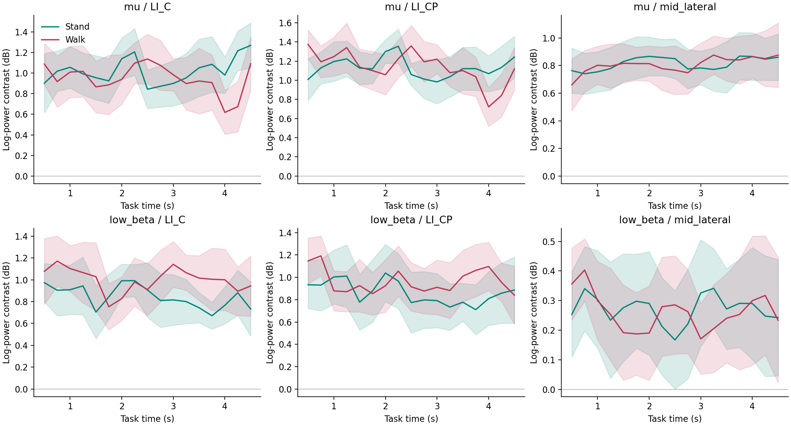
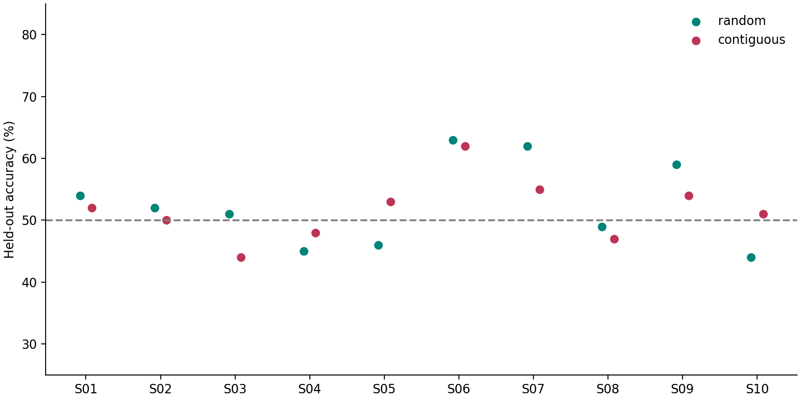

# 8채널 EEG Stand–Walk 재분석 결과

2026-10-09. 대상: 기존 10명, Rest·Stand·Walk 각 50시행, 총 1,500시행. **이미 여러 분석을 거친 같은 자료의 후향적 탐색**이다. 독립 재현, 사전등록 연구, 제출 가능한 완성 논문으로 취급하지 않는다.

## 먼저 결론

**MI와 mu/beta 반응의 연관성은 문헌에 근거가 있다. 하지만 현재 자료의 고정 8–13 Hz 변화만으로 MI 수행이나 운동 피질 발생원을 확정할 수는 없다.** 참고 논문은 원 프로토콜의 발표자 노트와 코드 설명 자료에서 직접 찾았다.

**Stand–Walk 정보가 완전히 없다고 하기도 어렵다.** 시간별 파워를 사용한 고정 모델에서 평균 55.9%가 관찰됐고, 이번 23개 후보×두 평가 방식을 대상으로 한 사후 최대값 순열검정은 p=.015였다. 다만 이 값은 같은 자료에서 나온 최고 모델의 성능이며, 새 자료에서 보장되는 정확도가 아니다. 모델을 고르는 과정까지 포함하면 다섯 무작위 분할 평균은 52.1%, 시간 블록 분리에서는 51.6%였다. 높은 정확도의 안정적 분류라고 할 수 없다.

**전환 시점·시작 방향·반복 여부를 유연하게 다뤄도, 보행의 좌우 교대 반응을 일관되게 확인하지 못했다.** 그렇다고 참가자가 심상을 하지 않았거나, 측정에 모든 관련 정보가 없었다고 확정한 것은 아니다.

**사람 간 공통 분류도 아직 약했다.** 무보정 참가자 전체 보류 평가는 48.0%, 시행별 크기 정규화는 49.5%, 시험 참가자의 레이블 없는 세션 자료를 활용한 보정은 52.4%였다. 마지막 평가는 새 사람의 무보정 예측과 다르다.

## 1. 무엇을 근거로 실험했는가?

인수인계 PPTX의 16번·24번 슬라이드 발표자 노트에는 Ma et al. (2023)의 *A New Compound-Limbs Paradigm: Integrating Upper-Limb Swing Improves Lower-Limb Stepping Intention Decoding From EEG*가 명시돼 있다. 별도 코드 설명 PPTX 19번 슬라이드는 Pfurtscheller et al. (2006)의 *Mu rhythm (de)synchronization and EEG single-trial classification of different motor imagery tasks*를 ERD/ERS 분석의 참고로 적고 있다. 정확한 위치·검색 범위는 [프로토콜 검토](protocol_and_hypotheses.md)에 있다.

Ma 논문의 핵심 대비는 **왼다리+오른팔 대 오른다리+왼팔**이다. 우리 대비는 **기립 대 두 걸음 보행**이다. 팔·다리 협응을 활용한다는 발상은 이어지지만 분류 문제는 같지 않다. 원 논문이 우리 Stand–Walk 분리를 보였다고 하거나, 반대로 우리 구현에서는 복합사지 요소가 절대로 도움이 안 된다고 결론낼 수 없다. [Ma 2023 본문 사본](https://www.researchgate.net/publication/373966293_A_New_Compound-limbs_Paradigm_Integrating_upper-limb_swing_improves_lower-limb_stepping_intention_decoding_from_EEG), [독립 원문 검증 C06–C09](source_verification.md).

문서의 보행 지시는 오른발+왼팔로 시작해 오른발·왼발 총 두 걸음이다. 실제 전환 시점, 반복 횟수, 실제 시작 방향을 계측한 기록은 없다. 사용자가 설명한 다른 수행 가능성을 모두 가설로 남기고, 2.5초 전환에 의존하지 않는 특징을 포함했다.

## 2. mu 대역에서 MI가 확실한가?

**일반 배경으로서의 연관성과 현재 시행의 판정은 다르다.** 손 MI의 반대측 감각운동 리듬 감소는 원 연구에서 관찰됐다. 그러나 같은 주파수대의 두피 신호 변화만으로 개인의 MI 수행을 고유하게 식별한다는 보장은 아니다. [Pfurtscheller & Neuper 1997, 출판사 초록](https://www.sciencedirect.com/science/article/pii/S0304394097008896).

위치도 중요하다. 2006년 연구에서는 발/혀 심상 중 **손영역 mu 증가**와 발 심상 중 **중앙 영역 mu 감소**를 함께 보고했다. 따라서 '모든 운동 심상은 모든 중앙 전극에서 mu가 감소한다'도, '발 심상은 mu가 증가하므로 우리 증가가 운동 반응이다'도 적절하지 않다. 해당 연구는 60전극, 개인별 반응 대역, 다른 심상 동작을 사용했다. 우리 Cz/CPz의 고정 8–13 Hz 복합보행을 직접 검증한 자료가 아니다. [2006년 저자 공개 전문](https://pub.ista.ac.at/~schloegl/publications/pfurtscheller2006.pdf).

또 시각 단서형 발 심상의 go/nogo 실험에서는 MI를 억제하도록 한 조건에도 초기 beta 감소가 관찰됐다. 단서·준비 반응과 더 오래 지속되는 MI 관련 반응을 구분해야 한다는 근거다. 이것을 '모든 ERD가 단서 때문'이라는 주장으로 확대하지 않는다. [Pfurtscheller et al. 2013](https://www.frontiersin.org/journals/human-neuroscience/articles/10.3389/fnhum.2013.00379/full).

따라서 현재 자료에서는 다음을 각각 질문했다.

1. 지시된 조건에 따라 EEG 특징이 달라지는가?
2. 그 특징이 보지 않은 시행의 조건을 예측하는가?
3. 그 특징이 운동심상 고유의 피질 반응이라는 근거가 있는가?

1·2에 대한 약한 단서가 3의 확인을 대신하지는 않는다.

## 3. 이번 계산과 평가

### 자료와 신호 특징

- FC3, FC4, C3, C4, Cz, CP3, CP4, CPz **8채널 전체**를 사용했다. 이 배열은 운동영역 주변에 모여 있다. 앞뒤 채널이 있어도 전두극·후두극까지 포함하는 전뇌 몽타주는 아니다.
- 기존 보존 규칙과 Rest/Stand/Walk 코드 2/5/8을 유지했다. 13개 런에서 총 1,500시행을 사용했고, 이번 cue/구간/포화 기준의 추가 탈락은 0개였다. 포화가 없다는 사실은 눈·근육·움직임 오염이 없다는 뜻이 아니다.
- 귀 참조와 CAR를 비교했다. 4–8, 8–13, 13–20, 20–30 Hz의 고정 연속 필터를 사용했다. 공분산은 OAS로 수축해 수치 안정성을 확보했다.
- 파워 특징은 과제 0.5–4.5초의 네 개 1초 로그파워 평균, 변화 특징은 과제 1–5초의 네 개 1초 로그파워 평균에서 fixation -4.5..-2.5초의 두 개 1초 평균을 뺐다. 평균·로그 순서와 창 길이를 맞췄다.
- 시간 궤적은 0.5초 창을 0.25초씩 움직여 17개 값을 구했다. 좌우쌍, 측방 평균, 중앙 대비 측방, 앞뒤 대비도 계산했다.
- 자유 전환점 대비는 전환 시점을 고정하지 않고 가장 큰 앞뒤 차이의 **크기**를 구한다. SD·범위·평균 중심 교차·0.2–1 Hz 변조는 반복과 시점 변이에 대응하는 요약이다. 시행별 레이블 없이 계산하지만, 잡음에서도 큰 값이 생길 수 있다.

시간창을 모두 합친 값을 여러 가상 시행으로 쪼개 학습·시험에 나누지 않았다. 한 시행은 항상 같은 평가 쪽에 속한다. 단, 연속 신호의 고정 양방향 필터는 인접 시간의 신호를 섞을 수 있어 완전한 실시간 인과 필터 평가와는 다르다.

프로토콜 자료는 Stand/Walk 시작의 1초 beep를 명시한다. 시간 궤적과 0.5초부터 시작하는 특징에는 이 첫 구간의 일부가 포함된다. 문서에 적힌 자극을 실제 원 코드/음원과 대조하지는 못했으며, 해당 시간 특징을 순수한 심상 활동으로 간주하지 않는다.

### 분류와 불확실성

23개 후보는 파워, 기준선 변화, 시간 궤적, 시간 요약, 결합 특징, 필터뱅크 공분산을 로지스틱 회귀·RBF SVM·ExtraTrees·CSP/LDA·리만 접공간 모델로 처리했다. 새로운 딥러닝이나 EEG foundation model을 학습한 것은 아니다.

개인 내 평가는 외부 5-fold, 내부 3-fold로 모델을 선택했다. 표준화·CSP·접공간 참조는 학습 폴드 안에서 맞췄다. 시간 블록 평가는 시험 블록 양옆의 기립/보행 선택 시행 1개씩도 학습에서 제외했다. 이는 세션 안의 시간 블록 일반화이며, 미래 시점만 예측하는 전진 평가나 다른 날 세션 평가는 아니다.

참가자 간 평가는 한 사람 전체를 보류하는 LOSO이고, 내부 선택도 참가자 그룹을 분리했다. 10명이 집단 요약 단위다. 반복 CV를 독립적인 50명 표본처럼 세지 않았다. 아래 95% 구간은 참가자 분포에 대한 탐색적 t 구간이다. LOSO에서는 학습 집합 중첩 때문에 구간을 추가로 조심해 읽어야 한다.

## 4. 처리된 신호에서 무엇이 보였는가?

### 4.1 기존 중앙 mu 결과는 같은 방향으로 재현됐다

Cz·CPz 평균, 과제 후반 대비 fixation의 8–13 Hz 변화:

| 참조 | Rest | Stand | Walk | Stand/Walk에서 감소한 참가자 |
|---|---:|---:|---:|---:|
| 귀 참조 | +0.46 dB | +1.16 dB | +1.61 dB | 각각 3/10명 |
| CAR | +0.23 dB | +0.46 dB | +0.92 dB | 각각 4/10명 |

두 조건의 지속적인 중앙 mu 감소가 대다수에게 보인다는 예상은 이번 지표에서는 지지되지 않았다. 다만 Rest도 변화하고 조건별 선행 단서가 다르다. 이 증가를 특정 운동 기전, 이완, 시각적 주의, 근전도의 어느 하나로 확정하지 못한다. 출처: `within_condition_change.csv`의 mu, Cz/CPz 참가자별 평균.

위 표는 과제 후반 평균에 관한 결과다. 짧은 초기 감소와 이후 증가가 함께 있을 가능성을 모두 부정하는 표가 아니다. 세부 시간 bin은 `task_change` 로컬 배열에 보존했다.

### 4.2 좌우 교대는 일관되게 검출되지 않았다

Walk–Stand의 측방 평균 편측성 궤적 요약 예:

| 대역·참조 | 특징 | Walk–Stand 평균 | 참가자 간 95% 구간 | 예상 방향(+) 참가자 |
|---|---|---:|---:|---:|
| mu, 귀 | 자유 전환점 대비 | +0.006 dB | -0.128..+0.140 | 6/10 |
| mu, 귀 | 시간 SD | -0.034 dB | -0.109..+0.042 | 5/10 |
| 저 beta, 귀 | 자유 전환점 대비 | +0.185 dB | +0.020..+0.351 | 8/10 |
| 저 beta, 귀 | 시간 SD | +0.076 dB | -0.001..+0.154 | 9/10 |
| 저 beta, CAR | 자유 전환점 대비 | -0.080 dB | -0.166..+0.006 | 1/10 |
| 저 beta, CAR | 시간 SD | -0.080 dB | -0.109..-0.052 | 0/10 |

여기서 저 beta는 13–20 Hz다. 귀 참조의 저 beta 자유 전환점 차이는 예상 방향이지만, 앞/뒤 25시행에서 모두 양수였던 참가자는 3/10명이었다. CAR에서는 방향도 같지 않았다. CAR의 저 beta SD 감소는 10명에게 같은 방향이라는 기술적 공통점이 있지만, 예상한 'Walk의 더 큰 좌우 교대'와 반대이고 참조에 민감하다.

참조×대비마다 네 대역·14궤적·8요약과 32개 baseline 변화 지표를 포함한 **480개 검사**에 Holm 보정을 적용했다. **t검정에서는 CAR 지표 두 개가 통과했다.** CPz mu 파워 궤적의 느린 변조량은 Walk에서 더 컸다(차이 +0.05857, 로그10 변조량 단위, 보정 p=.04878, 전원 양수). 측방 평균 편측성의 저 beta 범위는 Walk에서 더 작았다(차이 -0.30581 dB, 보정 p=.00724, 전원 음수). 전자는 좌우 교대 자체가 아닌 단일 채널의 파워 변조이며, 후자는 예상한 더 큰 교대와 반대다. 이 탐색적 차이를 없었던 것으로 처리하지 않되, 참조·지표·분포 가정에 따른 결과로 남긴다.

정확 부호 순열의 Holm 보정에서는 통과한 지표가 없었다. 그러나 10명의 양측 정확 부호 순열검정 최소 p는 2/1024=.001953이고 Holm 첫 기준은 .05/480=.000104이므로, **현재 설정에서는 이 절차로 통과하는 것이 구조적으로 불가능하다.** 이를 강한 음성 근거로 사용하지 않는다. 기존 로컬 보고서의 '보정을 통과한 지표가 없었다'는 문장은 2026-10-10 공개 검토에서 위와 같이 정정했다. 계산 결과 CSV는 바꾸지 않았다. 출처: `signal_summary.csv`, `signal_participant_differences.csv`.

그림은 귀 참조의 참가자 평균±1 SE다. LI_C/LI_CP는 오른쪽−왼쪽 로그파워다. 지속적인 양의 값 자체를 특정 운동 반구의 활성이라고 해석하지 않는다. 그림의 겹침이나 부호만으로 개별 시행의 분류 가능성을 판정하지 않는다.

## 5. 분류 결과

### 5.1 모델 선택까지 포함한 결과

| 평가 | 평균 정확도 | 참가자 간 95% 구간 | 의미 |
|---|---:|---:|---|
| 개인 내 무작위, 첫 분할 | 52.5% | 47.6–57.4% | 내부 검증으로 후보 선택 후 외부 평가 |
| 개인 내 무작위, 5개 분할 seed 평균 | 52.1% | 47.5–56.7% | 참가자별 반복 평균 후 10명 요약 |
| 개인 내 시간 블록 | 51.6% | 48.0–55.2% | 인접 시행 일부를 제외한 시간 블록 평가 |
| 무보정 LOSO | 48.0% | 44.0–52.0% | 시험 참가자의 집단 통계량을 쓰지 않음 |

균형 잡힌 50/50 이진 대비라 개인별 전체 보류 예측의 정확도와 균형정확도는 같다. 첫 무작위 평가의 단서 전 고정 대조 분류기는 49.7%, 시간 블록에서는 50.2%였다. 이 대조가 기회 수준이라는 사실만으로 과제 구간의 다른 교란이 배제되지는 않는다.

다섯 무작위 seed의 nested 평균은 52.5%, 54.6%, 49.9%, 52.5%, 51.1%였다. 가장 높은 seed를 선택하지 않고 모두 평균했다. 출처: `within_person_summary.csv`, `split_stability_summary.csv`, `cross_person_summary.csv`.

### 5.2 그래도 약한 조건 정보는 있을 수 있다

고정된 시간 궤적+로지스틱(C=.01)의 첫 무작위 외부 평가 평균은 55.9%였다. 같은 모델의 다섯 분할 평균은 55.3%(참가자 간 기술적 95% 구간 51.6–59.0%)였다. 이는 '최고 55.9%' 한 점만 나온 경우보다는 안정적이지만, 이 모델에 주목한 것 자체가 같은 자료를 본 뒤의 선택이다.

이 선택 문제를 일부 평가하기 위해, **23개 고정 후보×두 평가 방식의 최대 참가자 평균**을 대상으로 199회 레이블 순열검정을 했다. 레이블은 런 내부 시간순 기립/보행 선택 시행 10개 이하 블록 안에서 섞었다. 매 순열마다 모든 고정 모델과 평가를 다시 적합했다.

- 관찰 최대 평균: **55.9%**.
- 순열 최대값 분포의 평균: **53.18%**. 50%가 아닌 이유는 매번 여러 후보 중 최고를 뽑기 때문이다.
- 순열 최대값 분포의 95백분위: **55.31%**.
- 관찰값 이상인 순열: **2/199회**. +1 보정 p = **.015**.

**좁은 해석:** 정한 블록 교환가능성 가정과 이번 후보군 안에서는 무작위 레이블만으로 설명하기 어려운 약한 조건 정보가 관찰됐다. 그러나 이 검사는 이전 Claude 탐색 전체와 과거 연구자 선택까지 보정한 것이 아니고, nested 모델 선택 절차의 순열검정도 아니다. 199회 몬테카를로의 해상도·오차도 있다. 이를 독립 검증된 55.9%나 MI 고유 정보의 증명으로 바꾸지 않는다. 출처: `blocked_search_test.json`, `blocked_search_permutations.csv`.

**왜 고정 모델 55.3%와 nested 52.1%가 다른가?** 고정 모델은 같은 규칙을 모든 외부 폴드에 사용한다. nested 절차는 작은 학습 자료의 내부 검증 결과로 매번 모델을 고르므로 선택이 불안정할 수 있다. 이는 현재 결과에 대한 방법론적 설명 후보이며, 그 원인을 별도 실험으로 확정한 것은 아니다. 최고 모델만 사후 채택한 정확도와 실제 선택 알고리즘의 평가를 구분해야 한다.

### 5.3 시간 전환을 유연하게 다룬 모델도 크게 높아지지는 않았다

자유 전환점·변동·변조 등의 전체 요약 특징을 쓴 고정 모델들은 첫 무작위 평가에서 50.3–52.3%, 시간 블록에서 51.5–52.1%였다. 고정 시간 궤적을 유지한 일부 모델이 더 높았지만, 이것으로 정확한 좌우 걸음을 복원했다고 할 수 없다. 과제 시작에 맞춘 일반적인 시간 변화도 궤적에 포함된다. 출처: `fixed_candidate_summary.csv`의 `ear_dynamic_*`, `ear_trajectory_*`.

## 6. 8채널과 전처리는 도움이 됐는가?

같은 파워 로지스틱 모델과 같은 분할로 채널 수를 맞춰 비교했다.

| 특징 | 무작위 | 시간 블록 |
|---|---:|---:|
| 중앙 2채널(Cz/CPz) | 53.0% | 52.6% |
| 측방 6채널 | 50.9% | 52.6% |
| 전체 8채널 | 51.4% | 52.3% |

8채널 사용으로 뚜렷하게 개선됐다는 결과는 없었다. 그렇다고 측방 채널이 불필요하다고 결론내릴 수는 없다. 정해진 특징·모델에서 채널을 늘리면 정보와 함께 추정할 항목도 늘어난다. 이번 주요 후보들은 이미 전체 8채널을 사용했다.

같은 8–30 Hz 공분산 모델에서, 시행·채널별 중앙값±6 MAD 범위를 벗어난 극단값만 제한하는 전처리도 비교했다. 무작위 정확도는 52.9%에서 52.5%, 시간 블록은 52.8%에서 52.5%였다. 이 처리로 높은 성능이 나타나지는 않았다. 바뀐 샘플의 평균 비율은 귀 참조에서 참가자별 약 0.0002–0.0301%로 작았다. **이 결과는 눈·근육 오염 제거의 성공/실패를 평가한 것이 아니다.** 해당 전처리가 그런 오염을 충분히 제거하는지 확인할 참조 신호가 없다. 출처: `matched_controls_summary.csv`, `matched_control_differences.csv`, `winsorization_fraction.csv`.

30–45 Hz/8–30 Hz의 과제 파워 비율도 별도 계산했다. 귀 참조의 Rest/Stand/Walk 평균은 -9.22/-9.33/-9.67 dB, CAR는 -10.03/-10.02/-10.25 dB였다. 이 비율이 조건마다 다르거나 낮다는 사실로 EMG 유무를 진단하지 않는다. 분모인 감각운동 대역 파워 변화만으로도 비율은 달라질 수 있다. 이 진단은 새로운 분류 후보나 앞의 최대값 순열검정에 포함하지 않았다. 출처: `high_band_proxy_participant.csv`.

## 7. 사람 간 공통점은 더 보정하면 보이는가?

첫 LOSO 결과 이후 두 가지 추가 민감도를 확인했다. 각 모델의 C는 학습 참가자들 안의 그룹 분할에서 선택했다.

| 평가 | 정확도 | 참가자 간 기술적 95% 구간 | 시험 신호 사용 범위 |
|---|---:|---:|---|
| 무보정, 원 후보군 선택 | 48.0% | 44.0–52.0% | 해당 시험 시행의 특징만 변환 |
| 공분산 trace 정규화 | 49.5% | 45.7–53.3% | 시행마다 자기 크기로 정규화 |
| 참가자별 공분산 whitening | 52.4% | 49.6–55.2% | 시험 참가자의 레이블 없는 150시행으로 세션 참조 적합 |

세션 보정은 사람마다 다른 신호 수준·공분산 구조를 줄이려는 검사다. 정확도 숫자만으로 무보정 대비 개선이 확인됐다고 주장하지 않는다. 마지막 행은 시험 세션의 분포를 활용하는 **transductive 오프라인 보정**이므로 완전히 처음 보는 사람의 즉시 예측과 다르다. 다른 방법·보정·표본에서 공통 특징을 찾을 가능성은 여전히 열려 있다. 출처: `alignment_summary.csv`, `alignment_scope.json`.

## 8. Garbage In, Garbage Out을 어떻게 이해할까?

잡음이 많아도 일정한 패턴이 신호에 남아 있다면 필터, 공간 특징, 반복 학습, 적절한 사전학습 모델로 예측에 활용할 수 있다. 그래서 처음 성능이 낮았다는 이유만으로 자료 전체를 버릴 필요는 없다. 이번에도 약한 조건 정보의 단서가 남았다.

다만 모델이 **기록되지 않은 사실을 복구했다고 검증할 방법은 없다.** 실제 심상 시작·걸음 시점·눈·근육 상태를 기록하지 않았다면, 복잡한 모델이 그럴듯한 출력을 만들어도 그것이 실제 수행이나 운동 피질 신호인지 따로 확인해야 한다. 좋은 분류 모델이 단서·주의·세션·근긴장 차이를 잘 이용할 수도 있다.

따라서 현 자료를 무조건 'garbage'라고 부르는 것도, 모델 성능이 올라가면 '순수 MI를 복원했다'고 부르는 것도 피해야 한다. 현재 가장 정확한 표현은 **측정된 조건 정보는 약하고, 운동심상 고유 발생원과 실제 수행에 대한 식별은 제한돼 있다**이다.

## 9. 이번에 답한 것과 남은 것

| 질문 | 답변 수준 |
|---|---|
| 원 실험 참고 문헌이 있는가? | 발표자 노트와 코드 설명에서 직접 확인 |
| mu/MI 배경은 근거가 있는가? | 원 연구의 연관성은 확인, 우리 시행의 MI 확인과는 구분 |
| 2.5초가 아닌 전환·반복을 고려했는가? | 자유 전환점·변동·변조·교차 및 시간 궤적 모델을 실제 계산 |
| 8채널을 모두 사용했는가? | 주요 특징·공간 모델에서 전부 사용, 별도 채널 대조도 수행 |
| Stand–Walk 정보가 전혀 없는가? | 단정 불가. 제한적 사후 검사에서 약한 라벨 정보 관찰 |
| 높은 정확도로 안정되게 구분하는가? | 이번 선택·시간 블록·사람 간 평가에서는 확인 못 함 |
| 그 정보가 순수 MI인가? | 확인 못 함. EOG/EMG·행동 대조·시행별 수행 기록 부족 |
| 실패 원인을 특정했는가? | 특정 못 함. 참조·수행·개인차·측정·특징·평가 불확실성을 분해해 범위를 좁힘 |

다음 수집의 우선순위는 무조건 채널 수나 모델 규모를 늘리는 것이 아니라, 심상 동작을 분명히 나누고 실제 수행/좌우 전환 시점을 확인할 기록, 균형 잡힌 단서 대조, 눈·근육 참조, 별도 세션 검증을 갖추는 것이다. 이것은 현재 데이터에서 원인을 밝혔다고 주장하는 문장이 아니라, 남은 경쟁 설명을 구분하기 위한 설계 제안이다.

## 재현·감사 상태

코드와 실행 방법은 [저장소 README](../../../README.md), 분석 계획과 사후 추가는 [계획 기록](analysis_plan.md)에 있다. 입력 checksum과 시행별 파생 배열은 로컬에만 보존한다. 공개 manifest의 소스 hash는 10월 9일 계산 당시 코드의 값이며, 배포용 경로 변경과 재실행 검사는 [배포 기록](RELEASE.md)에서 구분한다. 4개 가상 신호/분할/학습 변환 검사는 통과했다. 이는 실제 심상 걸음을 검출할 생리학적 민감도를 검증한 것이 아니다.

표준화된 가정 점검은 참가자별 nested 정확도 차이 10개에 적용했다. 무작위/시간 블록의 Shapiro-Wilk p=.383/.846이었으나, 비유의성을 정규성이나 참가자 독립성의 증명으로 쓰지 않았다. 신호 대비에는 정확 부호 순열 민감도도 기록했다.

문헌 주장에는 새 맥락의 독립 검증자를 사용했다. 1997은 초록 수준이어서 전체 본문 검증은 미완료다. 수치·코드는 로컬에서 작성·실행·검사했으며 인간 연구자의 최종 감사와 제출 승인은 남아 있다. 원자료・식별자・시행별 파생 배열은 배포하지 않는다. 2026-10-10 공개 준비에서 코드를 저장소 경로에 맞게 옮기고 선택한 집계 결과와 보고서를 추가했다.
